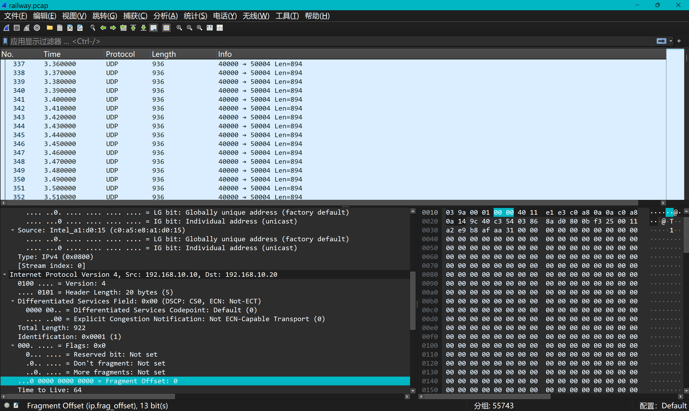
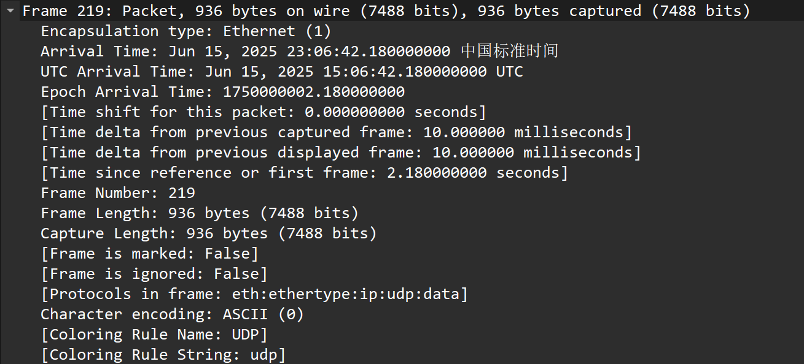
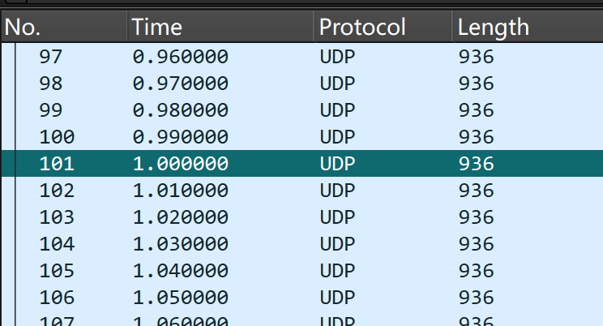
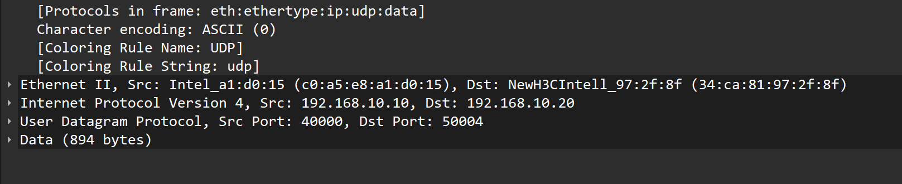

# 流量分析！？

# wireshark界面简析

第一次做流量题，听说wireshark是分析流量的利器？但打开wireshark的一瞬间很懵，中文菜单栏和英文协议解析鱼龙混杂，五颜六色细长条铺满屏幕...不妨先随便挑一个题，边查边做，生啃硬做，学习一下wireshark的界面。

**人民铁路为人民**
>来源：ISCTF2026 MISC （2026/11/18）

拖入wireshark的一瞬间是这样：


## 协议解析框（协议树）

聚焦在左下方的协议分析框部分，先只看第一部分


### Frame物理帧
第一部分叫做Frame物理帧，是wireshark在抓包时自己生成的，并不是传输内容的本体，可以理解为快递单，不是货物本身，但传达一定信息。这里一共有19行，接下来逐行讲解：
```
Frame 219: Packet, 936 bytes on wire (7488 bits), 936 bytes captured (7488 bits)
Encapsulation type: Ethernet (1)
Arrival Time: Jun 15, 2025 23:06:42.180000000 中国标准时间
UTC Arrival Time: Jun 15, 2025 15:06:42.180000000 UTC
Epoch Arrival Time: 1750000002.180000000
[Time shift for this packet: 0.000000000 seconds]
[Time delta from previous captured frame: 10.000000 milliseconds]
[Time delta from previous displayed frame: 10.000000 milliseconds]
[Time since reference or first frame: 2.180000000 seconds]
Frame Number: 219
Frame Length: 936 bytes (7488 bits)
Capture Length: 936 bytes (7488 bits)
[Frame is marked: False]
[Frame is ignored: False]
[Protocols in frame: eth:ethertype:ip:udp:data]
Character encoding: ASCII (0)
[Coloring Rule Name: UDP]
[Coloring Rule String: udp]
```
1. `Frame 219: Packet, 936 bytes on wire (7488 bits), 936 bytes captured (7488 bits)`  
219是这个数据包的编号，在整个pcap文件中它是第219个。

2. `Encapsulation type: Ethernet (1)`   
直译：`封装类型：以太网`，标注的是数据链路类型，告知了应该用什么方式来解析整个流量包，被恶意更改就会导致混乱，只显示Frame物理帧。可以自己用十六进制编辑器改回来。

3. `Arrival Time: … 23:06:40.060` 中国标准时间的到达时刻，本地时区，精度到纳秒。  
`UTC Arrival Time: … 15:06:40.060 UTC`	同一时刻的 UTC（协调世界时，用原子钟计的，世界统一）写法，比本地少 8 小时。  
`Epoch Arrival Time: 1750000000.060000000`	Unix 时间戳：从 1970-01-01 起经过了17多亿秒。  
*Epoch（纪元）指的是1970-01-01 00:00:00 UTC，Unix 系统 1969 年诞生于贝尔实验室，开发者挑了第二年元旦这个整日子当起点，从此全世界程序沿用至今。  

4. 
`[Time shift for this packet: 0.000000000 seconds]	`人为时间偏移，0 = 没校正过。   

`[Time delta from previous captured frame: 10.000000 ms]`	**【值得关注】**与上一抓到的帧相差 10 毫秒。    

若间隔时间极其短，则可能是爆破密码操作；若等距则可能是心跳包，由程序定时发送的C2存活信号（C2即命令控制服务器，存活信号就是由被植入木马的机器定时发个小包，表明恶意软件依旧存活）；若整整齐齐则可能是脚本构造的痕迹，比如这道题：（其实数据包列表的time列（累计时间）更方便看出来时间差）  


`[Time delta from previous displayed frame: 10.000000 ms]`	**【过滤后值得关注】**与上一显示的帧相差 10 毫秒。     
这个时间差表明的是“这个协议和显示出的上一个协议的时间差”，在使用过滤器后应该看的是这一个。而上面一个`previous captured`显示的是客观上一个抓住的包与此包的时间差。   
`[Time since reference or first frame: 60.000000 ms]`	距离第一帧 60 毫秒。  
 
5. `Frame Number: 7	`抓包文件中的帧序号。
`Frame Length: 936 bytes (7488 bits)	`帧长度＝线路长度。
`Capture Length: 936 bytes (7488 bits)`	捕获长度，与上面相等 → 完整抓到，没截断。
`[Frame is marked: False]	`没被手动打标记（标记高亮用于筛查）。
`[Frame is ignored: False]	`没被忽略；忽略的包会停止后续解析。
`[Protocols in frame: eth:ethertype:ip:udp:data]`	协议栈：以太网 → 类型字段 → IP → UDP → 载荷。冒号就是"拆快递"顺序。
`Character encoding: ASCII (0)`	字节面板里 ASCII 列按哪种编码显示。
`Coloring Rule Name: UDP / [Coloring Rule String: udp]`	命中着色规则，所以列表里这帧按 UDP 配色标注。

后面唯一有价值的是这个：
`[Protocols in frame: eth:ethertype:ip:udp:data]` 协议栈：以太网 → 类型字段 → IP → UDP → 载荷，反应的是拆包的路线图。

- eth 是以太网帧头，14 字节，前 6 位目的 MAC、后 6 位源 MAC，13、14位是ethertype。

- ethertype 不单独成一层，它eth里的第 13–14 字节。0x0800 表示里面是 IPv4，0x0806 表示 ARP。原理是"类型字段"——以太网拆完头，靠这个数字决定往哪分叉。Wireshark 特意单独列出来，是在提醒你：这里做了一次判断。

- ip 是网络层头，20 字节，装着源 IP、目的 IP、TTL、以及协议号。原理是端到端寻址——IP 管"从哪台机器到哪台机器"，和 MAC 只管下一跳不同。协议号 17 就是接力棒往下传的凭据。

- udp 是传输层头，8 字节：源端口、目的端口、长度、校验。原理是端口区分服务——53 是 DNS，123 是 NTP，UDP 不握手、不确认，快但不可靠。

- data 是剩下的载荷，是剥到 UDP 还没认出应用协议后得到的原始数据。

一句话总结，末尾决定了大方向：data 或 tls 结尾，说明加密或私有数据，需要去分析十六进制 ；http、dns 结尾是明文，右键 Follow Stream 直接分析数据流。而中间则是选择过滤器的依据，看到什么就过滤什么

往下看，这行其实和下面的信息是对应的！下面的协议树依次显示的便是：
