## wireshark界面简析

第一次做流量题，听说wireshark是分析流量的利器？但打开wireshark的一瞬间很懵，中文菜单栏和英文协议解析鱼龙混杂，五颜六色细长条铺满屏幕...不妨先随便挑一个题，边查边做，生啃硬做，学习一下wireshark的界面。

拖入wireshark的一瞬间是这样：
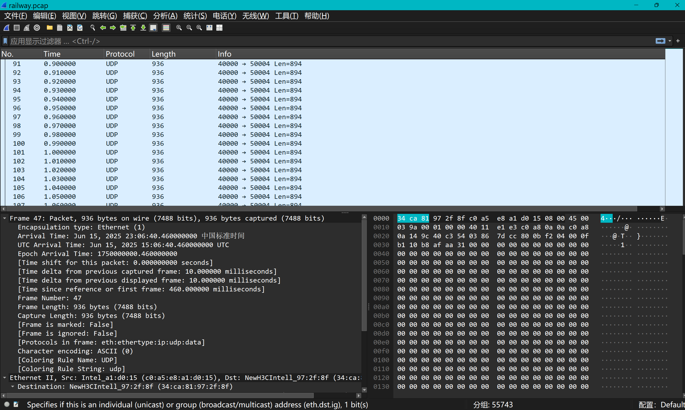

最上面是工具栏，其余3部分是数据包列表、协议解析框、数据包原始字节。

### 数据包列表

为啥是五颜六色的？


### 原始字节

为啥ASCII那一块是乱码？

右侧的ASCII部分只是把原始字节按每字节硬转码，因此正常情况下不会显示可读的明文。（当出现了明文，或者某部分重复出现时可引起警惕）


主要可以看看协议解析框：

### 协议解析框（协议树）

聚焦在左下方的协议分析框部分，先只看第一部分
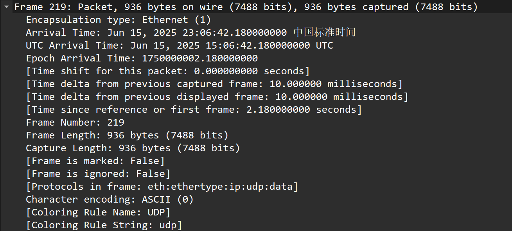

#### Frame物理帧
第一部分叫做Frame物理帧，是wireshark在抓包时自己生成的，并不是传输内容的本体，可以理解为快递单，不是货物本身，但传达一定信息。这里一共有19行，接下来逐行讲解：
```
Frame 219: Packet, 936 bytes on wire (7488 bits), 936 bytes captured (7488 bits)
Encapsulation type: Ethernet (1)
Arrival Time: Jun 15, 2025 23:06:42.180000000 中国标准时间
UTC Arrival Time: Jun 15, 2025 15:06:42.180000000 UTC
Epoch Arrival Time: 1750000002.180000000
[Time shift for this packet: 0.000000000 seconds]
[Time delta from previous captured frame: 10.000000 milliseconds]
[Time delta from previous displayed frame: 10.000000 milliseconds]
[Time since reference or first frame: 2.180000000 seconds]
Frame Number: 219
Frame Length: 936 bytes (7488 bits)
Capture Length: 936 bytes (7488 bits)
[Frame is marked: False]
[Frame is ignored: False]
[Protocols in frame: eth:ethertype:ip:udp:data]
Character encoding: ASCII (0)
[Coloring Rule Name: UDP]
[Coloring Rule String: udp]
```
1. `Frame 219: Packet, 936 bytes on wire (7488 bits), 936 bytes captured (7488 bits)`  
219是这个数据包的编号，在整个pcap文件中它是第219个。

2. `Encapsulation type: Ethernet (1)`   
直译：`封装类型：以太网`，标注的是数据链路类型，告知了应该用什么方式来解析整个流量包，被恶意更改就会导致混乱，只显示Frame物理帧。可以自己用十六进制编辑器改回来。

3. `Arrival Time: … 23:06:40.060` 中国标准时间的到达时刻，本地时区，精度到纳秒。  
`UTC Arrival Time: … 15:06:40.060 UTC`	同一时刻的 UTC（协调世界时，用原子钟计的，世界统一）写法，比本地少 8 小时。  
`Epoch Arrival Time: 1750000000.060000000`	Unix 时间戳：从 1970-01-01 起经过了17多亿秒。  
*Epoch（纪元）指的是1970-01-01 00:00:00 UTC，Unix 系统 1969 年诞生于贝尔实验室，开发者挑了第二年元旦这个整日子当起点，从此全世界程序沿用至今。  

4. 
`[Time shift for this packet: 0.000000000 seconds]	`人为时间偏移，0 = 没校正过。   

`[Time delta from previous captured frame: 10.000000 ms]`	**【值得关注】**与上一抓到的帧相差 10 毫秒。    

若间隔时间极其短，则可能是爆破密码操作；若等距则可能是心跳包，由程序定时发送的C2存活信号（C2即命令控制服务器，存活信号就是由被植入木马的机器定时发个小包，表明恶意软件依旧存活）；若整整齐齐则可能是脚本构造的痕迹，比如这道题：（其实数据包列表的time列（累计时间）更方便看出来时间差）  

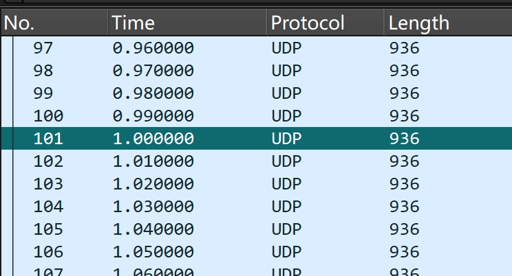
`[Time delta from previous displayed frame: 10.000000 ms]`	**【过滤后值得关注】**与上一显示的帧相差 10 毫秒。     
这个时间差表明的是“这个协议和显示出的上一个协议的时间差”，在使用过滤器后应该看的是这一个。而上面一个`previous captured`显示的是客观上一个抓住的包与此包的时间差。   
`[Time since reference or first frame: 60.000000 ms]`	距离第一帧 60 毫秒。  
 
5. `Frame Number: 7	`抓包文件中的帧序号。
`Frame Length: 936 bytes (7488 bits)	`帧长度＝线路长度。
`Capture Length: 936 bytes (7488 bits)`	捕获长度，与上面相等 → 完整抓到，没截断。
`[Frame is marked: False]	`没被手动打标记（标记高亮用于筛查）。
`[Frame is ignored: False]	`没被忽略；忽略的包会停止后续解析。
`[Protocols in frame: eth:ethertype:ip:udp:data]`	协议栈：以太网 → 类型字段 → IP → UDP → 载荷。冒号就是"拆快递"顺序。
`Character encoding: ASCII (0)`	字节面板里 ASCII 列按哪种编码显示。
`Coloring Rule Name: UDP / [Coloring Rule String: udp]`	命中着色规则，所以列表里这帧按 UDP 配色标注。

后面唯一有价值的是这个：
`[Protocols in frame: eth:ethertype:ip:udp:data]` 协议栈：以太网 → 类型字段 → IP → UDP → 载荷，反应的是拆包的路线图。（嵌套结构！由外到内）

- eth 以太网帧头。主要解决“数据是谁发给谁”，一共14 字节，前6位是目的 MAC、后6位是源MAC，13、14位是ethertype。

- ethertype 不单独成一层，它eth里的第 13–14 字节，用于说明后面封装的是什么协议。

- ip 是网络层头，负责解决：“数据应该发送到哪一个 IP 地址，经过哪些路由器才能到达目的地”

- udp 是传输层头，负责解决：“数据传入一台设备时应该交给哪个应用程序”

- data 是剩下的载荷，是剥到 UDP 还没认出应用协议后得到的原始数据。

注：
IP 地址：端到端寻址  
告诉网络数据最终要到哪里。  
MAC 地址：逐跳寻址  
告诉当前这一段链路的数据应该交给谁。  
（经过路由器转发时，通常 Ethernet 帧头中的 MAC 地址会改变，而 IP 源地址和目的地址通常保持不变）

**总结**

开头用来判断通信双方对象，中间用来确定协议类型（拿来过滤），末尾确定数据类型。

往下看，这行其实和下面的信息是对应的！下面的协议树依次显示的便是：
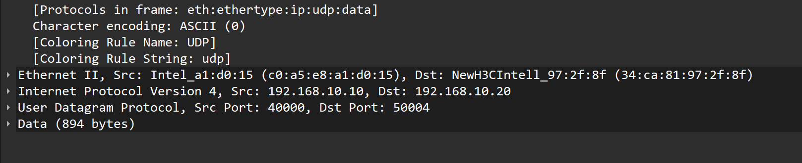

逐个板块分析一下：

#### Ethernet II
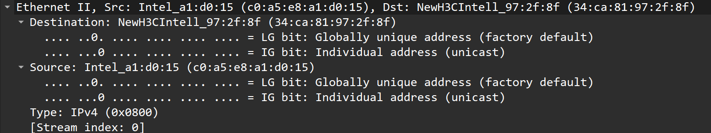

`Src: Intel_a1:d0:15(c0:a5:e8:a1:d0:15),`
`Dst: NewH3CIntel_97:2f:8f (34:ca:81:97:2f:8f)`

Src和Dst就是sourse和destination
的缩写，源MAC和目的MAC（描述的是当前链路上的通信双方，而不一定是整个网络通信的最终双方）

括号是原始的MAC，而`c0:a5:e8`被wireshark识别成了intel，因此显示英文，下一个同理。常见厂家名称和可能的设备类型：

Intel	可能是电脑网卡  
Apple	可能是 Apple 设备  
Cisco	可能是网络设备  
Huawei	可能是华为网络设备  
VMware	可能是虚拟机网卡  
（但改网卡/开虚拟机可伪造MAC）

下面分别对Dst和Src进行了展开分析：

```
    Destination: NewH3CIntel_97:2f:8f (34:ca:81:97:2f:8f)
        .... .... ..0. .... .... .... = LG bit: Globally unique address (factory default)
        .... .... ...0 .... .... .... = IG bit: Individual address (unicast)
```

这里2个 ..0.. 突出来的这个0是MAC地址的的关键标识位置，LG bit和 IG bit 

- LG：用于区分 MAC 地址是全局管理还是本地管理。0为全局（Globally unique），1为本地（Locally administered）。
- IG：用于判断目的 MAC 地址是发给单个设备，还是发给一组设备（单播还是组播）0为单播（Individual），1为组播（Group）。


sourse是同理的：
```
    Source: Intel_a1:d0:15 (c0:a5:e8:a1:d0:15)
        .... .... ..0. .... .... .... = LG bit: Globally unique address (factory default)
        .... .... ...0 .... .... .... = IG bit: Individual address (unicast)
```

（注：如果发现MAC是`ff:ff:ff:ff:ff:ff`则说明是广播）

`Type: IPv4 (0x0800)`:当前 Ethernet 帧的 Payload 中封装的是 IPv4 数据包。（看作分类标签，wireshark会按照它来解析协议）

`[Stream index: 0]`:wireshark给数据分配的Ethernet 流编号

#### IPv4

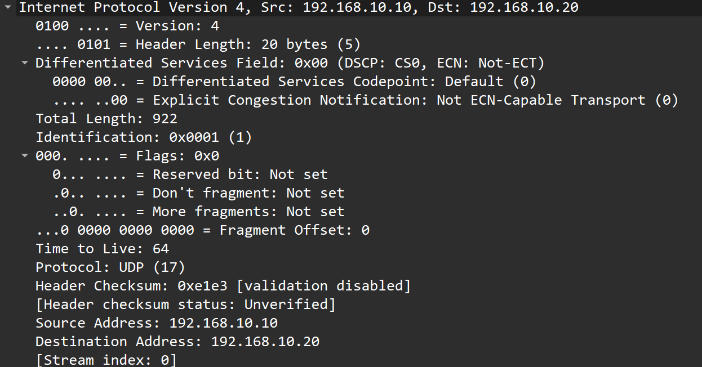

`Internet Protocol Version 4, Src: 192.168.10.10, Dst: 192.168.10.20 ` 
    `0100 .... = Version: 4`

写明了通信双方的IP地址、IP版本、IP头部长度（不是UDP端口，那个是在下面的一栏里）

`    .... 0101 = Header Length: 20 bytes (5)`

代表表示 IPv4 头部占用 20 字节（不重要）

`    Differentiated Services Field: 0x00 (DSCP: CS0, ECN: Not-ECT)`
`        0000 00.. = Differentiated Services Codepoint: Default (0)`
`        .... ..00 = Explicit Congestion Notification: Not ECN-Capable Transport (0)`

DSCP：用于区分不同服务质量。  
ECN：用于显式拥塞通知。

这一坨大致表示数据包的服务质量和拥塞通知信息（不重要）

`    Total Length: 922`
这里的总长度由IP头的20字节（见上面）和902IP负载构成

`   Identification: 0x0001 (1)`
这是 IPv4 的标识字段。当IP数据包较大需要拆分时，它们使用相同的标识值，接收端就能根据相关字段判断这些分片属于同一个原始数据包。

````
这一坨不太重要）
    000. .... = Flags: 0x0  #注意这不是flag XD
        0... .... = Reserved bit: Not set  
        .0.. .... = Don't fragment: Not set
        ..0. .... = More fragments: Not set
    ...0 0000 0000 0000 = Fragment Offset: 0

DF	0	没有禁止分片
MF	0	后面没有更多分片
Offset	0	从原始数据开头开始


    Time to live: 64
TTL表示数据包允许经过的最大路由转发次数，当前还剩64次。
    Protocol: UDP (17)
使用UDP传输
    Header Checksum: 0xe1e3 [validation disabled]
    [Header checksum status: Unverified]
头部校验值，检查IPv4 头部坏了没
    Source Address: 192.168.10.10
    Destination Address: 192.168.10.20
    [Stream index: 0]
````
**总之这一坨可以不怎么看，因为关键信息在流量包概览处都会标出来（要是有缺的可以右键显示）**

```
User Datagram Protocol, Src Port: 40000, Dst Port: 50004
    Source Port: 40000
    Destination Port: 50004
    Length: 902
源端口、目标端口、长度（含8字节的总长度，因此纯应用数据是后面的894字节）
    Checksum: 0x7370 [unverified]
    [Checksum Status: Unverified]
    [Stream index: 0]
校验值和wireshark自己给的编号
    [Stream Packet Number: 53]
在UDP流中的编号
    [Timestamps]
        [Time since first frame: 520.000000 milliseconds]
        [Time since previous frame: 10.000000 milliseconds]
字面意思，离第一个包的时间和离上一个的时间。
    UDP payload (894 bytes)
正如前面所说，纯数据载荷是894字节
```
可以顺带总结一下目前出现的各种长度：
Frame Length: 936 bytes
IPv4 Total Length: 922
UDP Length: 902。
UDP Payload: 894

可以从中窥见一层层封装的结构~

当鼠标在左侧选中时，右侧的数据包原始字节也会有对应的显示（右侧的ASCII部分只是把原始字节按每字节硬转码，因此正常情况下不会显示可读的明文。当出现了明文，或者某部分重复出现时可引起警惕）
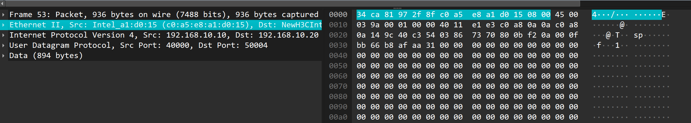

#### data

最后一层就是data了。为了更好的分析data，我们可以开始了解一些具体的分析方法了——

### 右键？

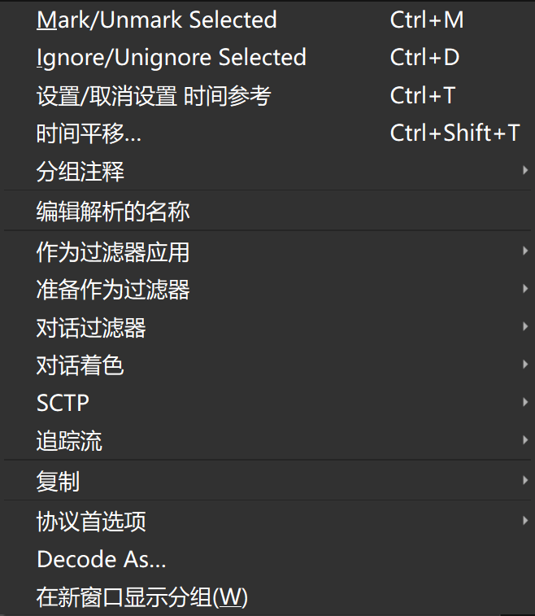

```
Mark/Unmark Selected     Ctrl+M 可以给数据包打上标记
Ignore/Unignore Selected    Ctrl+D 忽略数据包（不会删除）想恢复按菜单栏的Edit找相关选项
设置/取消设置 时间参考    Ctrl+T 之后的数据包会把这个数据包作为开始来记录时间

时间平移（不用管）
分组注释 （不用管）
编辑解析的名称 不用管）

作为过滤器应用 > 把鼠标放在哪里，就用哪里的条件作为显示过滤器，免得手敲（当然还是得学会手敲，所以也没啥用）

对话过滤器 > 差不多，都是过滤用的

对话着色 > 字面意思

在新窗口显示分组(W)  字面意思

SCTP > 布吉岛 应该没用

复制 > 比较有用
 
协议首选项 > （最好不乱动

Decode As  可以指定wireshark按照某种协议来解析浏览量包
```
上面其实自己右键试试就清楚了。

唯一的经常用的是**追踪流**，可以把属于同一条通信的相关数据包关联起来，按照通信方向和顺序集中观察

> 好的可以开始刷题了 Let's Gooooo~

## 喵喵喵

*大部分流量题目是一个pcap或pcapng起手，在看懂大致过程并提取关键数据后，流量分析的使命差不多就结束了，接下来就进入misc隐写或web领域了。下面的题目会重点记录流量分析这个前导部分。*

### 人民铁路为人民
>来源：ISCTF2026 MISC （2026/11/18）

UDP流，发现时间间隔时间都是完美的0.1秒

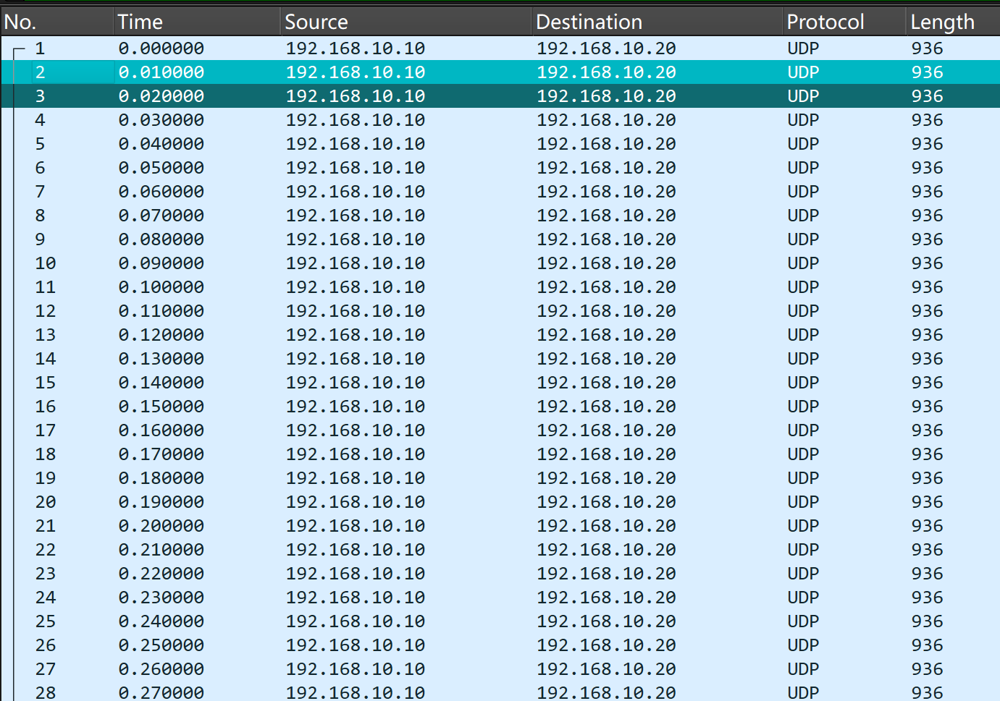

追踪流发现每个数据包只有开头部分有一点点数据，其余位置都是0填充
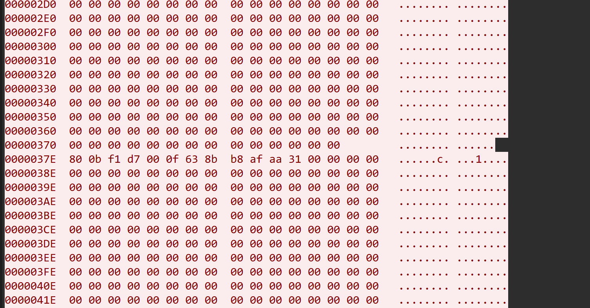

考虑使用tshark + python组合拳把数据过滤出来（tshark是Wireshark官方提供的命令行网络协议分析工具）

比如这个题：
`tshark -r railway.pcap -Y "udp"

这里可以用`tshark -r railway.pcap -Y "udp" -T fields -e udp.payload > extract.txt`把所有udp流的载荷提取到一个txt文件。

| 指令 | 作用 | 
|--|--|
|-r	| 读取 PCAP 文件|
|-Y "udp"|	只筛选 UDP|
|-T fields|	按字段导出|
|-e udp.payload	|UDP 负载内容|
|-e ...|(还可以指代提取其他某些部分)|
|> extract.txt	|保存为文件|

提取出来，前半段每一段载荷只有前面一小段字节内容，后面都是0；后面半段是满满的十六进制。
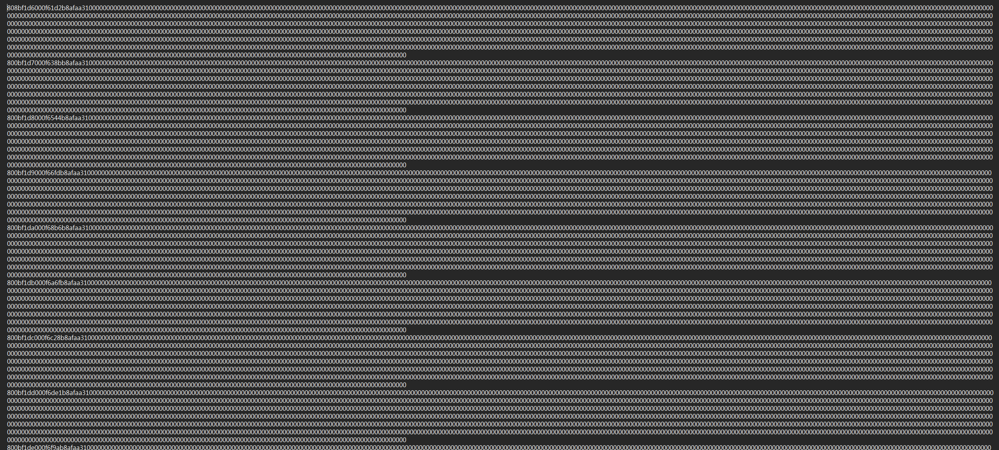

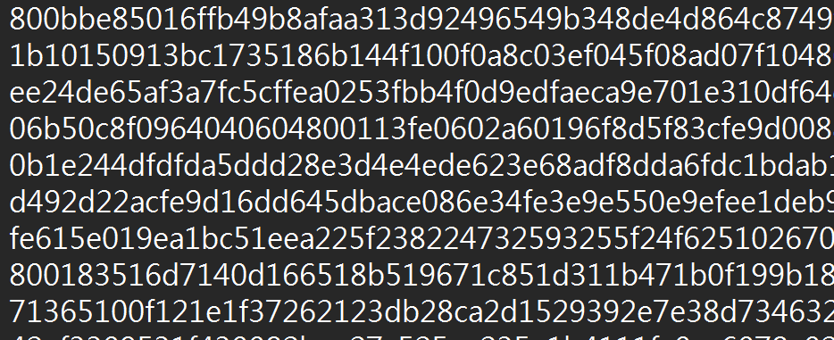
观察发现每段数据都是80开头，搜索发现是RTP音频的标识符，原来传输对象是一段音频。写一个脚本提取出音频，进入音频隐写misc领域（后续略）。

###
