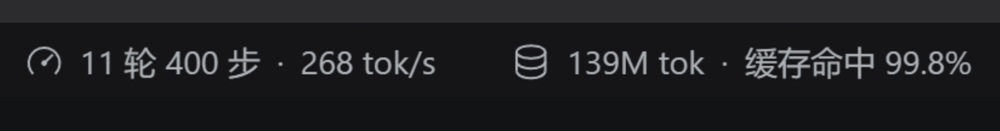
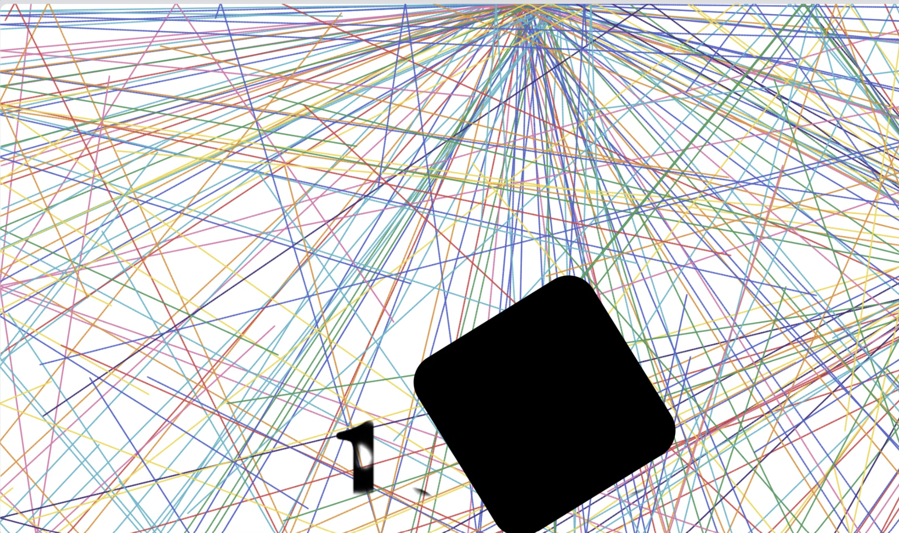

---
# 这是写作模板，不会被构建（id 以下划线开头，一律跳过）。
# 用法：复制这个文件，改成你的文件名，把 draft 改成 false 就发布。
title: 网站大迁徙
date: 2026-10-17
tags: [纯折腾]
draft: false
summary: 把静态生成器从Mkdocs迁移到了Astro
---

## 不急不急，静待鲜花盛开

一时兴起，想把这个网站打造成技术博客、学习笔记、作品集的复合体。于是乎，和模板循规蹈矩的Mkdocs的相比，Astro似乎更具有发展潜力。那就换个生成器吧！然而蓝色大肥鱼评价这是"治愈一个没有症状的病症的手术"，建议我使用双引擎驱动，前端网页设计用Astro，发博客还是Mkdocs的流程。

我听信谗言，折腾了一下午。显而易见，一山容不得二虎，本地预览的serve.cmd总是报错，博客字体总是不大兼容，粒子动效相当诡异...

罢了罢了，整站迁移Astro。让肥鱼整理了所有可以原封不动迁移的遗产，打包成zip，离家出走，新工作区，开梭。

这次采用苏格拉底式对话方法。“持续向我发问，没有97%把握之前，不准写一行代码”。

注意，这里大肥鱼才是苏格拉底，我才是不懂技术的愚蠢雅典居民。一直在接受拷问，肥鱼仿佛反客为主。不过好在有效，在回答完了60个问题后，成功搭出了看得过去的框架。

后续准备完善首页导览页的动效，加一些互动组件。

不急不急，慢慢折腾，未来会开出满地繁花。



## 好的我已急哭

（4个小时后）

吃白饭的蓝色大肥鱼！！！

我试图把我的头像变成一个超级炫酷的动效，动用了GLM帮我扣图，动用了deepseek网页版帮我写提示词，动用了modlens插件，动用了1500字的提示词，动用了20￥...

```prompt
 第一页的视觉效果要求如下：（仅限首页有吸附作用这一页
使用 Matter.js 物理引擎。请依据这张图片实现一个带物理模拟的 2D 动画效果。

页面背景为纯白色。（已经确认，就是纯白色，没有任何文字）第一页屏幕四周有不可见的物理墙壁和地板。墙壁和地板严格贴合屏幕的边界

图中的黑色方框一开始出现在页面正中间

（为保证效果，我们将整个过程分为3个部分）
第一部分：
【视觉与参数要求】

黑色方块要清晰，液滴颜色与给出的图片中完全相同（如原图中的红黄蓝绿紫等）。

代码必须完整，引入 Matter.js 的 CDN，包含渲染器配置（Render），并且逻辑必须连贯，不能有报错。【物理与动画逻辑】

初始状态：黑盒静止。左下角通过 Matter.js 的 Constraint（约束）固定在墙上，使其像合页一样可以旋转。

触发阶段：点进页面后，定时0.3秒
触发---
彩色线条原地碎裂成几十个彩色的小圆点（液滴），每个液滴都作为一个独立的物理刚体。

旋转与甩出阶段：

黑色方块在重力作用下，开始自然顺时针旋转。

旋转过程中，液滴受到重力（Gravity）影响下落，并受到旋转方块的碰撞挤压，被“甩”出方块。

最终静止阶段：

黑色方块因为物理惯性旋转到一定角度后，由于重力作用，最终重心会停留在左下角固定点的正下方（整个方块斜着挂着）

第二部分

--监听每一个液滴（圆形刚体）的 collisionStart（碰撞开始）事件。

当液滴碰到屏幕底部或左右墙壁时，触发以下逻辑：

取消重力：将该液滴的物理刚体移出引擎（或者 isStatic: true）。

图层调整：原本的黑色方块视觉上位于这些液滴的底层（液滴飞到方块上面）。

分裂与运动：将该液滴分裂成 2 个新的微小粒子。这两个粒子不再受物理引擎控制，而是以碰撞点为中心，生成两个任意方向的随机速度（vx, vy），做匀速直线运动。

绘制轨迹：这两个粒子移动时，在 Canvas 上留下永不消失的彩色线条（拖尾）。他们也会和墙壁发生碰撞，分裂，随机射出...以此类推

重要限制：为防止死机，请设置一个全局变量 maxSplitDepth（最大分裂深度，例如 3）。超过深度的液滴碰撞后不再分裂，只反弹并持续画线。

请提供一个独立的背景 Canvas 专门用来画这些彩色线条，不要每次刷新都清空它。

当页面加载（或点击后）达到 5秒时，开始在画面中心用 JS 代码（或 SVG 动画）逐笔手写出英文 "badbadsheep"。用黑色。字体用网站里其他英文用的那个。用3.5秒写完badbadshee 
（写的时候，液滴仍在反复碰撞划线）
2. 特殊效果：在写到字母 "p" 的最后一笔时候，放慢书写速度，添加类似毛笔枯笔、飞白的拖尾皴效果（可以使用 Canvas 的 globalCompositeOperation = 'destination-out' 或者特定的粒子滤镜实现）。（整个p用1秒写完
3. 瞬间反转：当 "p" 的拖尾结束时，触发全局状态改变：
整个网页的背景（最底层）瞬间变成纯黑色。
文字 "badbadsheep" 瞬间变成纯白色。
所有粒子静止在原地0.3秒，之后回复重力，自由落体掉下来，直接掉出屏幕消失不见。

最终，屏幕上只有黑底白字的badbadsheep
下方，缓缓出现字体较小的 Welcome to my world ^^
```
杰作如下


“deepseek，我要批判你！”

“没错，这副作品的确有很多值得批判的地方。playing → inverted → final的时间轴根本没有跑通，并且...”

“？”


我已疾苦。


